# Quota Sentry Enforcement Flow

<!-- markdownlint-disable MD013 -->

## Document Status

This document describes the behavior implemented at commit `082f444` on
2026-08-16. It is a retrospective baseline, not evidence that every behavior
was requested or approved.

The stale/unknown-state denial described below was introduced by Codex without
an approved state-flow design. It must not be treated as an accepted product
requirement merely because it exists in code, tests, or documentation.

No runtime behavior is changed by this document.

## Implemented Health And Cadence Amendment (2026-11-02)

The historical `082f444` behavior documented later in this file is superseded
for daemon health and unlatched telemetry. The user-approved rule is now
implemented: Quota Sentry preserves a confirmed block, but its own source or
daemon health does not reject unrelated Codex work when no block is retained.

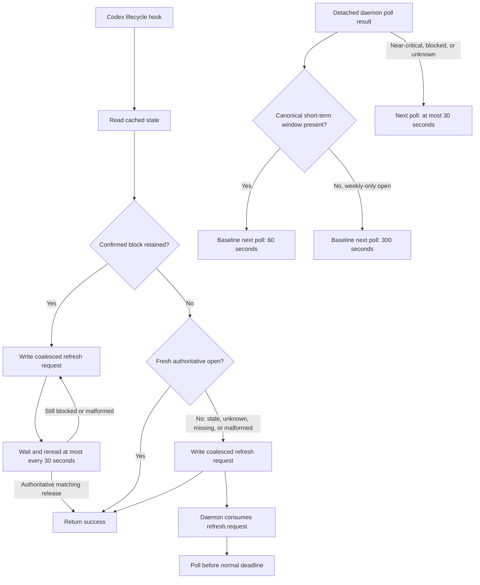

### Implemented Hook Truth Table

| Cached effective state | Retained block? | Hook action | Daemon action | Codex outcome |
| --- | --- | --- | --- | --- |
| Fresh `open` | No | Return success | Normal adaptive cadence | Continue |
| Stale `open` | No | Request refresh and return success | Poll before normal deadline | Continue |
| `unknown`, fresh or stale | No | Request refresh and return success | Poll before normal deadline | Continue |
| Missing or malformed state | No observable latch | Request refresh and return success | Poll before normal deadline | Continue |
| `blocked` with valid timestamps | Yes | Request refresh, wait, and reread | Poll at most every 30 seconds | Pause until authoritative release |
| `blocked` with invalid timestamps | Yes | Request refresh and wait on a rolling 30-second recovery horizon | Repair or replace state through polling | Pause; never deny for malformed timing data |
| `blocked` with `sourceStatus: unknown` | Yes | Preserve latch and wait | Retry source at most every 30 seconds | Pause until authoritative release |
| Daemon start or refresh fails without a retained block | No | Fall through to cache-only guard, request recovery, and return success | Retry on a later hook/start | Continue |
| Unexpected internal hook exception | Unknown | Existing event-specific failure handling remains | N/A | Outside this amendment |
| Confirmed block reaches the 366-day watchdog | Yes | Existing event-specific watchdog remains | N/A | Outside this amendment |

`UserPromptSubmit`, `PreToolUse`, `PostToolUse`, and `PreCompact` all use this
same cache decision. None performs a live quota poll. The hidden
`--require-fresh-state` argument remains accepted for already-loaded sessions,
but it no longer converts unlatched telemetry health into a denial.

The daemon now waits against a wall-clock deadline instead of counting a fixed
number of one-second sleeps. A system sleep therefore cannot leave the old
sleep remainder to run after wake. `refresh.request` is a single coalesced file;
multiple hooks do not create an unbounded poll queue.

## Revision 4 Feasibility Decision

**Status on 2026-09-30: `REJECTED`; production implementation is
`BLOCKED`.**
The [provider-admission feasibility report](docs/superpowers/reviews/2026-09-29-provider-admission-feasibility-report.md)
records a reproducible exact-candidate contract violation. Tasks 1-3 passed
against `codex-cli 0.144.6`. In Task 4, direct `/responses/compact` timed out at
four configured idle intervals. Holding the original gateway request beyond
that deadline caused Codex to mark the original turn failed; forwarding the
same retained body once afterward could not resume it.

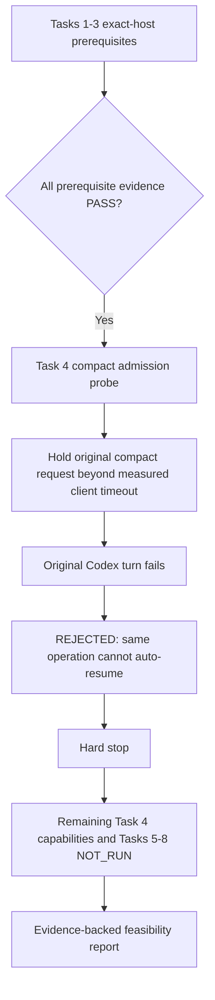

No implementation may proceed from the Revision 4 design below. Its decisions
and diagrams are retained as historical/proposed architecture only. The only
defensible next steps are an upstream/fork primitive that can suspend compact
timeout accounting and expose a supported non-model status, or a separately
approved narrower product contract. Neither is production authorization.

## Mandatory Change Approval Gate

No future change to quota classification, state persistence, latch release,
daemon recovery, hook waiting, hook output, timeout behavior, or failure policy
may be implemented before all of the following happen:

1. Update or replace the affected flow diagram in a proposed revision of this
   document.
2. Include a before/after truth table for every affected state.
3. State exactly what happens for fresh open, stale open, unknown, missing,
   malformed, and previously confirmed blocked state.
4. State whether Codex continues, waits, or receives a hook denial at every
   affected lifecycle event.
5. Obtain explicit user approval of the proposed diagram.
6. Only after approval, write or change implementation tests and production
   code.

Approval cannot be inferred from an incident report, a request to investigate,
or a general request to make Quota Sentry safer. If the diagram was not shown
and explicitly approved, the behavioral decision is not approved.

## Terminology

Quota Sentry currently has two distinct kinds of state, although several code
paths incorrectly blur them:

- **Source observation**: the latest result from Codex app-server. Its
  `sourceStatus` is `open`, `blocked`, or `unknown`.
- **Enforcement latch**: remembered evidence that a quota policy was confirmed
  blocked. Its `enforcement.status` is `open` or `blocked`.
- **Effective status**: top-level `status` consumed by hooks. It is normally
  `blocked` while any enforcement latch survives, even if `sourceStatus` has
  become `unknown`.
- **Fresh**: `updatedAt` is no more than 420 seconds old and is not in the
  future.
- **Authoritative**: a Codex app-server observation with sufficient identity
  and timestamp evidence to supersede an existing latch.

## Runtime Architecture

This diagram shows the complete runtime path at a high level.

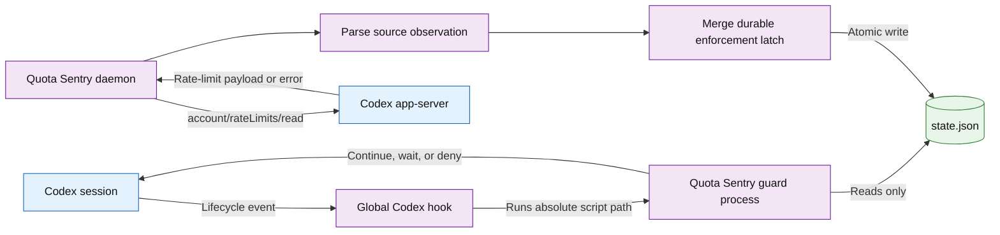

Important current boundaries:

- The daemon is the only installed component intended to call the live quota
  source.
- Installed guard hooks use `--state-only`; they do not live-poll.
- Hook JSON input is fully consumed but discarded. Fields such as `cwd`,
  `session_id`, and `prompt` do not influence policy.
- One global state file controls every Codex session on the machine.

## Source Observation Flow

This diagram describes `parse_codex_usage` and the decisions produced from one
poll. It does not yet include preservation of a previous block; that is the
next diagram.

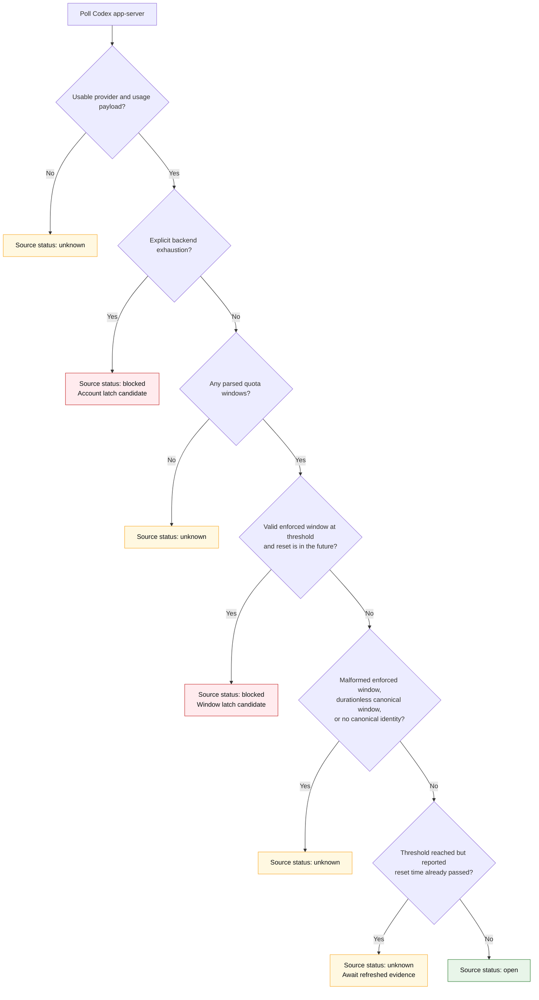

### Implemented Window Policies

| Source evidence | Current classification | Current threshold |
| --- | --- | --- |
| Canonical window up to 24 hours | Short term | Block at `usedPercent >= 90` (preserve 10%) |
| Canonical seven-day window, approximately 10,080 minutes | Weekly | Block at `usedPercent >= 99` by default |
| Weekly policy explicitly configured as advisory | Weekly advisory | Never creates a weekly latch |
| Explicit `rateLimitReachedType` or spend-control exhaustion | Account | Block immediately, even without windows |
| Canonical unfamiliar long-term window | Long term | Block at `100%` |
| Canonical window without usable duration | Unknown | Source observation becomes `unknown` |
| Auxiliary non-canonical window beside a canonical window | Advisory metadata | Does not independently block |
| Multiple replacement buckets without a canonical identity | Unknown | Source observation becomes `unknown` |
| Valid blocking window plus malformed sibling | Blocked | Valid blocking evidence wins |

`auto` currently means Codex app-server only. CodexBar is used only when
explicitly selected and has lower source authority.

## Durable Enforcement Latch Flow

This is the implemented persistence policy. It contains the behavior the user
has explicitly reaffirmed: once a block is known, stale or unknown telemetry
must not silently release it.

### Unlatched Observation Transitions

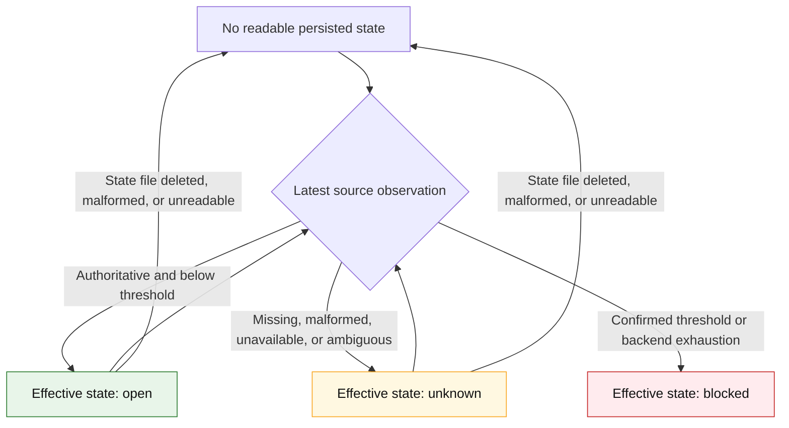

### Confirmed-Block Retention and Release

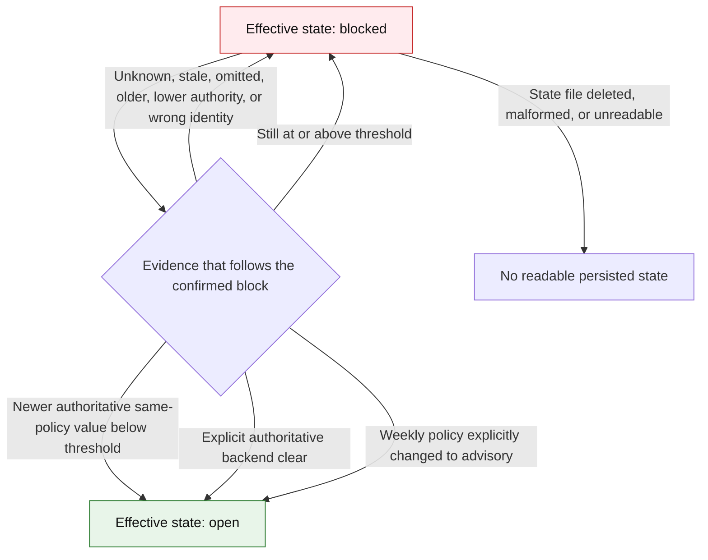

### Latch Release Requirements

A remembered latch is retained when any of these conditions hold:

- The source poll fails or returns `unknown`.
- The relevant window is omitted.
- Backend exhaustion fields are omitted rather than explicitly cleared.
- The new observation is older than the previous source observation.
- The new source has lower authority.
- Canonical limit identity does not match.
- A relevant sibling window is malformed.
- The estimated `blockedUntil` time passes without positive release evidence.

A latch is cleared only by newer, authoritative, matching evidence below the
policy threshold, an explicit backend clear, or an explicit policy opt-out.

Current durability has one material limit: `read_state` converts a missing,
unreadable, or malformed state file to `{}`. If `state.json` is lost or
corrupted, the process also loses its remembered block evidence.

## Daemon Flow

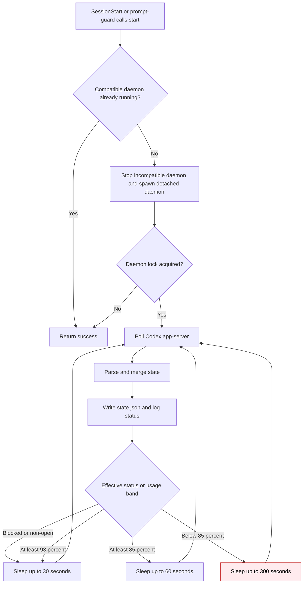

The sleep loop counts one-second sleeps. It has no explicit wake-from-system-
sleep detection and no hook-to-daemon refresh request. A hook cannot make the
daemon poll immediately.

### Implemented Sleep/Staleness Failure Path

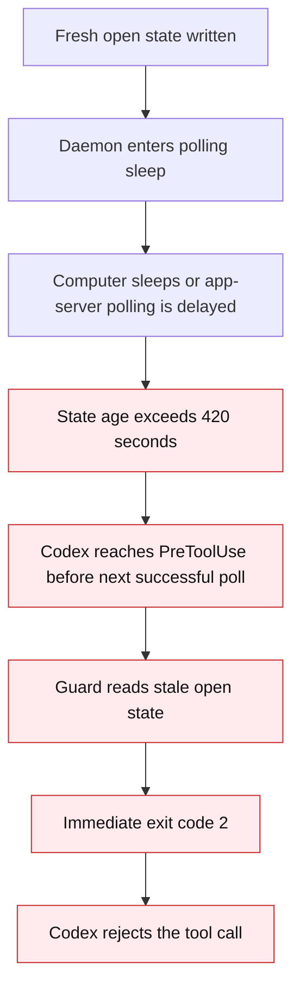

This path caused the observed message:

```text
PreToolUse hook (blocked)
feedback: Quota Sentry: cached quota state is unavailable or stale; refusing to fail open.
```

## UserPromptSubmit Flow

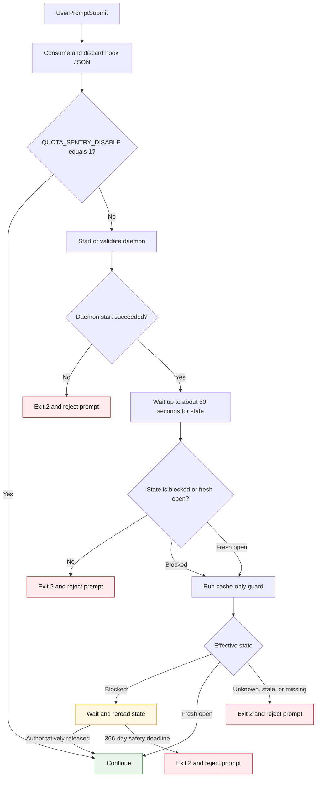

`wait_for_fresh_quota_state` treats `blocked` as acceptable regardless of age,
so a known block reaches the guard and remains waiting. It accepts only a fresh
`open` state otherwise. A fresh `unknown` state is rejected after the startup
wait.

## PreToolUse, PostToolUse, and PreCompact Flow

All three installed checkpoint hooks call the same cache-only guard. They differ
only in the denial format returned to Codex.

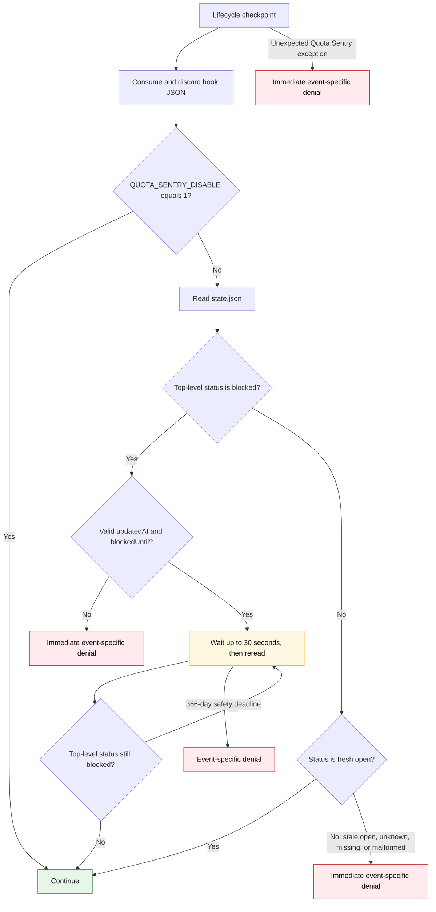

The critical implementation error is the `H7 -> D3` edge. The guard checks
freshness before entering any waiting loop. There is no `refreshing` state and
no retry path for stale or unknown unlatched state.

## Current Hook Outcome Truth Table

This table is the authoritative human-readable summary of current hook
behavior.

| Cached effective state | Fresh? | Previous confirmed block retained? | Current installed-hook action | Live poll from hook? | Codex outcome |
| --- | --- | --- | --- | --- | --- |
| `open` | Yes | No | Return success immediately | No | Continue |
| `open` | No | No | Emit unavailable/stale denial immediately | No | Reject current lifecycle operation |
| `unknown` | Yes | No | Emit unavailable/stale denial immediately | No | Reject current lifecycle operation |
| `unknown` | No | No | Emit unavailable/stale denial immediately | No | Reject current lifecycle operation |
| Missing or malformed state file | No | Block evidence is unavailable | Emit unavailable/stale denial immediately | No | Reject current lifecycle operation |
| `blocked`, valid timestamps | Yes | Yes | Wait and reread at most every 30 seconds | No | Pause until release |
| `blocked`, valid timestamps | No | Yes | Ignore staleness and keep waiting | No | Pause until release |
| `blocked` with `sourceStatus: unknown` | Either | Yes | Keep waiting on retained latch | No | Pause until release |
| `blocked`, missing or malformed timestamps | Either | Ambiguous | Emit unavailable/stale denial immediately | No | Reject current lifecycle operation |
| Any state with bypass environment variable | Either | Either | Return success | No | Continue |
| Any guard path throws unexpectedly | N/A | Not evaluated reliably | Convert exception into event-specific denial | No | Reject or stop current lifecycle operation |
| Confirmed block reaches internal 366-day watchdog | N/A | Yes | Emit event-specific denial | No | Reject or stop current lifecycle operation |

## Event-Specific Denial Shapes

| Hook event | Installed command behavior | How current health failures are surfaced |
| --- | --- | --- |
| `SessionStart` | Starts detached daemon | Nonzero start result is a hook failure |
| `UserPromptSubmit` | Starts daemon, checks freshness, then guards | Exit code `2`; prompt is rejected |
| `PreToolUse` | Cache-only guard | Exit code `2`; tool is rejected before execution |
| `PostToolUse` | Cache-only guard | JSON `decision: block`; completed tool is not undone and feedback replaces its result |
| `PreCompact` | Cache-only guard | JSON `continue: false`; compaction is stopped |

The same telemetry-health condition therefore has different side effects based
on whichever lifecycle event encounters it first.

## Unapproved and Harmful Design Decisions

The following decisions were made by Codex during implementation. They were not
presented as a complete state machine for user approval.

### HD-01: Conflated block preservation with universal fail-closed behavior

The valid requirement was: **do not clear a previously confirmed block merely
because telemetry becomes stale or unavailable**.

The implementation expanded that into: **deny lifecycle activity whenever
there is no fresh open observation, even when no block has ever been
confirmed**.

Those policies are not equivalent.

### HD-02: Made stale and unknown state an immediate operation rejection

`wait_if_blocked` emits `HOOK_STATE_UNAVAILABLE_MESSAGE` and returns the hook's
blocking result before any wait or recovery attempt. This directly caused
`PreToolUse` to reject an otherwise valid tool call.

### HD-03: Combined `--state-only` with `--require-fresh-state`

Installed checkpoint hooks demand fresh state while being forbidden from live
polling. No alternative refresh channel was implemented. When freshness is
lost, the hook can only deny.

### HD-04: Omitted a telemetry-recovery state

There is no `refreshing` or bounded-recovery branch between “cache is stale”
and “reject Codex operation.” The system lacks a way to pause briefly while the
daemon refreshes an unlatched state.

### HD-05: Gave hooks no way to wake the daemon

The daemon may sleep for five minutes, but a lifecycle hook cannot request an
immediate poll. This is especially harmful after system sleep or a transient
app-server failure.

### HD-06: Made daemon scheduling unaware of system sleep

The daemon uses a one-second-counting sleep loop without detecting wall-clock
jumps or wake events. A cache that was fresh before sleep can be stale when
Codex resumes, before the daemon has refreshed it.

### HD-07: Used a narrow freshness margin without a recovery path

Normal polling is every 300 seconds and freshness expires at 420 seconds. The
120-second margin can be consumed by system sleep, scheduler delay, a 15-second
app-server timeout, or transient source failures. Crossing it causes immediate
denial.

### HD-08: Made prompt submission fail when daemon health is bad

`prompt-guard` returns exit code `2` when daemon startup fails or no fresh state
arrives during its startup wait. A Quota Sentry health problem is therefore
presented as a reason to reject the user's prompt.

### HD-09: Converted internal Quota Sentry exceptions into quota denials

The top-level CLI catches unexpected exceptions in installed guard mode and
returns a PreToolUse denial, PostToolUse block, or PreCompact stop. Internal
software defects are indistinguishable from an enforcement decision.

### HD-10: Used one misleading message for several different states

“Cached quota state is unavailable or stale; refusing to fail open” covers a
stale open observation, fresh unknown source, missing file, malformed file,
and malformed blocked state. It does not tell the user what failed or whether a
quota block was ever observed.

### HD-11: Discarded hook context

The hook process drains JSON stdin to avoid TTY ownership bugs but does not
parse or retain it. Directory, session, prompt, and event context cannot inform
policy or diagnostics.

### HD-12: Encoded the bad policy as a successful autonomous test

Unit tests explicitly assert that stale nonblocked and fresh unknown state
return a blocking result. Autonomous scenario `AT-020` is named “fresh unknown
state fails closed” and reports denial as a pass. The test suite therefore
protected the wrong requirement.

### HD-13: Published the bad policy as contributor guidance

The README, command documentation, skill instructions, and contributing guide
state that unknown or stale hook state must fail closed. Documentation made an
unapproved inference look like settled product policy.

### HD-14: Did not require a state-machine approval artifact

Behavior was changed through code and tests without first presenting the
combined source, latch, daemon, and hook state flow. Review occurred at the
level of individual fixes, hiding the harmful interaction between them.

### HD-15: Used one global effective status for every session

The daemon writes one machine-wide top-level `status`; hooks do not make a
session-specific decision. This prevents directory- or purpose-aware policy and
makes all active sessions inherit the same health and enforcement result.

### HD-16: Called the latch durable without protecting against state-file loss

The latch survives source failures but not deletion, corruption, or unreadable
`state.json`. That boundary was not made explicit when the behavior was
described as durable.

## Current Decisions That Serve a Valid Safety Requirement

These are listed separately so correcting the harmful health-failure behavior
does not accidentally remove valid quota protection. Their inclusion here does
not waive the approval gate for future changes.

- A confirmed block remains effective through stale, missing, malformed,
  omitted, older, lower-authority, or identity-mismatched source observations.
- Passing an estimated reset time does not itself release a confirmed block.
- A confirmed block clears only with newer authoritative matching evidence,
  explicit backend-clear evidence, or explicit policy opt-out.
- Explicit backend exhaustion blocks even when percentage windows are absent.
- Default `auto` source does not silently downgrade from Codex app-server to a
  third-party source.
- Quota policy is based on window duration and canonical identity rather than
  `primary` or `secondary` slot names.
- Hook stdin is consumed before a long wait so Codex does not suspend on TTY
  input.
- The daemon is detached from hook stdin and owns the only normal live-polling
  path.
- Installed blocking hook timeouts are longer than weekly or annual reset
  windows, avoiding the earlier six-hour host timeout.

## Code and Test Map

| Behavior | Implementation location |
| --- | --- |
| Source parsing and `open` / `blocked` / `unknown` decision | `src/quota_sentry/core.py::parse_codex_usage` |
| Previous-latch preservation and release | `src/quota_sentry/core.py::_merged_enforcement_windows` |
| Effective persisted status | `src/quota_sentry/core.py::state_from_decision` |
| State freshness | `src/quota_sentry/core.py::state_is_fresh` |
| Cache-only hook decision and waiting | `src/quota_sentry/core.py::wait_if_blocked` |
| Hook definitions and timeout shapes | `src/quota_sentry/core.py::merge_codex_hooks` |
| Daemon cadence | `src/quota_sentry/cli.py::daemon_command` |
| Prompt startup and freshness gate | `src/quota_sentry/cli.py::prompt_guard_command` |
| Event-specific denial output | `src/quota_sentry/cli.py::guard_command` |
| Unexpected hook exception conversion | `src/quota_sentry/cli.py::main` |
| Stale and unknown rejection unit tests | `tests/test_quota_sentry.py` |
| Fresh-unknown autonomous assertion | `scripts/autonomous-test::scenario_fresh_unknown_state_fails_closed` |

## Approval Record

| Revision | Status | Approval evidence |
| --- | --- | --- |
| Current implementation at `082f444` | Retrospectively documented; not approved as a complete flow | None |
| Hook-only wait-and-recover flow below | Superseded after real incident showed model-visible code-mode polling | Replaced on 2026-09-26 |
| Revision 3 elicitation plus Goal pause flow | Previously approved at a high level; invalidated by exact-source review | User reply `Approved!` on 2026-09-26, then superseded by finding that elicitation is not global |
| Revision 4 global-admission design | Historical/proposed target flow; feasibility `REJECTED`, production implementation `BLOCKED` | User approved the target contract on 2026-09-29; exact `0.144.6` failed compact same-operation preservation on 2026-09-30 |
| Isolated admission feasibility spike | Tasks 1-3 `PASS`; Task 4 `REJECTED`; Tasks 5-8 `NOT_RUN (hard stop)` | The original compact turn failed at its four-interval timeout while the front door retained one request; later release could not revive it |
| Isolated feasibility-spike plan | Approved and executed only as far as the first-non-`PASS` rule permits | `docs/superpowers/plans/2026-09-29-provider-admission-feasibility-spike.md`; controlling evidence is linked from the feasibility report above |

## Superseded Hook-Only Replacement Flow

This section is retained as historical design evidence. Its assertion that a
synchronous hook necessarily parks the complete Codex turn is false for nested
code-mode execution. It must not be implemented or treated as current approval.

### Hook Decision Flow

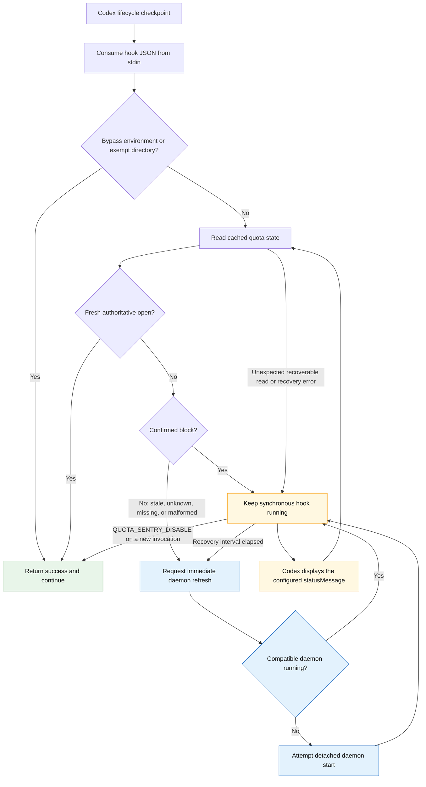

The hook never emits a deny, block, stop, feedback, additional-context, or
nonzero-exit response for quota telemetry health. It remains a synchronous
process while waiting, so Codex does not resume the model or tool operation.

`statusMessage` is the Codex-supported terminal progress channel. The message
is configuration metadata, not hook stdout, stderr, or model context. The
Codex hook schema does not define `notifyOnBlock`; Quota Sentry must not rely on
that unsupported field.

### Superseded Hook Outcome Truth Table

| Cached effective state | Fresh? | Confirmed block retained? | Hook action | Recovery action | Codex outcome |
| --- | --- | --- | --- | --- | --- |
| `open` | Yes | No | Return success immediately | None | Continue |
| `open` | No | No | Wait | Wake or restart daemon | Paused until fresh `open` or `blocked` |
| `unknown` | Either | No | Wait | Wake or restart daemon | Paused until fresh `open` or `blocked` |
| Missing or malformed state | No | Unknown | Wait | Wake or restart daemon | Paused until fresh `open` or `blocked` |
| `blocked` with valid reset estimate | Either | Yes | Wait and reread | Keep daemon polling; wake at recovery intervals | Paused until authoritative release |
| `blocked` without a valid reset estimate | Either | Yes | Wait and reread | Wake or restart daemon | Paused until authoritative release |
| Source fails after a block | Either | Yes | Preserve the in-process and persisted latch; wait | Retry source through daemon | Paused until authoritative release |
| Daemon is absent or incompatible | Any non-fresh-open state | Either | Wait | Attempt detached start; retry | Paused, never rejected |
| Daemon start or refresh attempt fails | Any non-fresh-open state | Either | Wait | Retry after bounded delay | Paused, never rejected |
| Hook watchdog deadline | N/A | Either | No internal denial watchdog | Continue waiting under the host timeout | Paused |
| Bypass environment or exempt directory | Either | Either | Return success | None | Continue |

### Event Outcomes

| Hook event | Fresh open | Blocked or telemetry unavailable | User-visible signal | Denial output |
| --- | --- | --- | --- | --- |
| `UserPromptSubmit` | Continue | Wait synchronously | Codex `statusMessage` while running | Never |
| `PreToolUse` | Continue | Wait synchronously | Codex `statusMessage` while running | Never |
| `PostToolUse` | Continue | Wait synchronously | Codex `statusMessage` while running | Never |
| `PreCompact` | Continue | Wait synchronously | Codex `statusMessage` while running | Never |

`SessionStart` remains a short daemon-start hook rather than an enforcement
checkpoint. A later blocking checkpoint performs recovery if startup failed.

### Recovery and Release Invariants

- Hooks remain cache consumers; the daemon remains the normal live quota-source
  owner.
- A waiting hook can request an immediate daemon poll and can restore a missing
  daemon without polling Codex app-server itself.
- Refresh requests are coalesced through a state-directory marker and bounded
  retry cadence to avoid a tight source-poll loop.
- Once a guard process observes `blocked`, missing, malformed, stale, or unknown
  state cannot release that process. Only a fresh authoritative `open` state
  can release it.
- The persisted latch rules in **Confirmed-Block Retention and Release** remain
  unchanged.
- Hook stdout and stderr remain empty during normal waiting and release.
- The emergency bypass remains explicit; telemetry failure is not converted
  into either a Codex denial or silent permission to consume quota.

## Superseded Revision 3 In-Place Parking Flow

This was the approved high-level behavior, but exact `0.144.6` source review
invalidated its enforcement boundary. Elicitation is awaited by code-mode
`exec` and `wait`; it is not a session-wide result-delivery or provider-call
barrier. Failed generic tools, ToolSearch, text-only responses, and an
increment-to-Goal-pause race can still reach another model request. This
section is retained as review history and must not be implemented.

The replacement draft is **Revision 4 Required Global Admission Flow** below.
Its detailed specification is
`docs/superpowers/specs/2026-09-26-in-place-quota-parking-design.md`.

### Required Runtime Topology

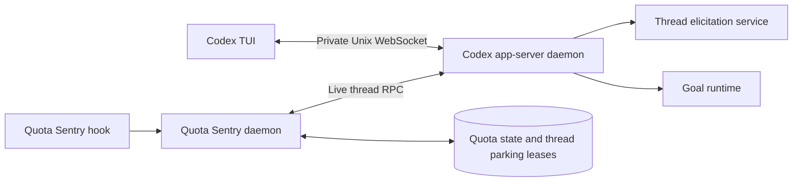

The TUI and Quota Sentry must address the same Codex app-server process. A
separately spawned stdio app-server can read persistent Goal state but cannot
apply runtime effects to the TUI's process-local Goal runtime.

`codex app-server proxy` is a raw byte relay, not a newline-delimited JSON-RPC
client. The control socket requires a WebSocket handshake and framing. The
implementation must qualify a real Unix-domain WebSocket transport against the
installed `0.144.6` daemon.

Quota Sentry must launch `codex app-server --listen unix://` directly from the
exact qualified `0.144.6` binary, or verify that an existing process has the
same path, hash, version, PID/start identity, and default socket. It must never
run `codex app-server daemon bootstrap`: that path can install an updater and
replace the live app-server with a newer binary. Setup must not stop or restart
an existing app-server or TUI implicitly.

The pinned daemon has to exist before a new TUI selects its app-server target.
At `SessionStart`, the session must appear in that daemon's
`thread/loaded/list`; a readable Goal record is not proof of live ownership.
An existing embedded session cannot be retroactively attached and must be
reported unqualified rather than represented as protected.

### Guarantee Boundary

The complete auto-resume path is guaranteed only when the session is loaded in
the pinned shared runtime, that runtime epoch remains unchanged, the hook and
Quota Sentry coordinator remain alive, each mutating RPC has an unambiguous
acknowledgment, and no other client races the final Goal ownership update.

Codex `0.144.6` exposes a shared elicitation counter, not an idempotent lease,
and exposes no Goal ID or compare-and-set revision. It therefore cannot support
exact crash recovery after a lost mutation response, race-free Goal ownership,
preservation across app-server restart, or preservation after Codex kills the
synchronous hook. Those states are marked indeterminate or unqualified; they
are never described as safely parked or automatically recovered.

The design also does not cancel an already submitted provider request, because
that would discard the active turn. Its measurable enforcement boundary is the
owning app-server's acknowledgment of the elicitation increment. From that
point, acceptance requires zero additional provider requests until release.

### Block, Park, And Resume

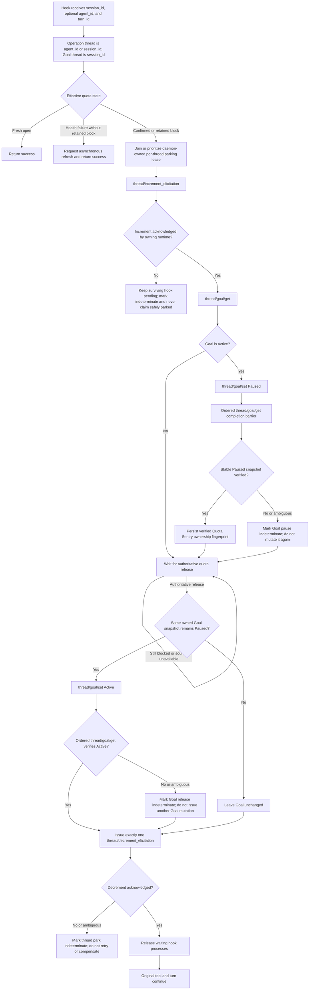

This superseded diagram intentionally preserves two now-rejected edges:
`PI -> W` can later release after an indeterminate initial pause, and `GI -> D`
can continue release after an indeterminate Goal activation. Neither edge is a
Revision 4 rule and neither may be implemented; Revision 4 keeps the complete
admission policy closed for both states.

The elicitation increment occurs before Goal mutation and before the long wait.
In `0.144.6`, code-mode `exec` and `wait` hold model-visible runtime responses
until elicitations clear. This closes the prior polling loop without rejecting
the tool or cancelling the turn.

For root hooks, `session_id` identifies both the operation and Goal thread. For
subagent hooks, `agent_id` identifies the thread whose tool result must be
parked, while `session_id` identifies the root Goal to pause.

The Quota Sentry daemon initiates parking when it confirms a block generation;
it intersects registered qualified threads with `thread/loaded/list` and does
not wait for a nested tool hook. It never mutates an unregistered loaded
thread. The outer code-mode `exec` tool has no PreToolUse boundary and may use
a zero-millisecond yield, so hooks only join or prioritize the daemon-owned
park. Release qualification must prove that no model-visible wait cycle occurs
after the elicitation increment is acknowledged.

Goal activation occurs before elicitation release. Because the original turn
is still active, activation cannot launch a competing idle continuation. Once
elicitation clears and the hook returns, the original operation continues and
normal Goal idle continuation follows.

Quota Sentry issues one decrement for its one acknowledged increment. It does
not repeatedly decrement to force the shared counter to zero; another valid
elicitation may own the remaining count. A lost increment or decrement response
cannot be safely guessed, retried, or compensated with the `0.144.6` API.

`thread/goal/set` sends its response before live runtime effects finish. Every
Goal write is therefore followed by an ordered same-thread `thread/goal/get`.
The `0.144.6` app-server serializes those requests across clients, making the
read a completion barrier before Quota Sentry advances the lease phase.

### Goal Ownership Boundary

The public `0.144.6` protocol does not expose the internal Goal ID or a
compare-and-set revision. Quota Sentry therefore records the complete public
snapshot returned before and after its pause. It automatically reactivates only
an unchanged snapshot that remains `Paused`.

If objective, creation timestamp, update timestamp, budget, usage counters, or
status changed, Quota Sentry releases the original operation but does not alter
the Goal. This avoids waking a Goal that the user or another client changed.

Even an unchanged read cannot prevent another client from writing between that
read and Quota Sentry's activation write. Automatic Goal reactivation is
therefore qualified on no concurrent Goal mutation during the final read/write
window. A failed post-write barrier is indeterminate and is not retried.

### Superseded Revision 3 Target Truth Table

| State | Hook action | Model outcome | Goal outcome |
| --- | --- | --- | --- |
| Fresh authoritative open | Return success | Continue | Unchanged |
| Unknown/stale/missing without retained block | Request asynchronous refresh and return success | Continue; never reject for Quota Sentry health | Unchanged |
| Confirmed block | Acquire or join parking lease and wait | No model-visible tool result while parked | Pause once if Active |
| Retained block plus stale/unknown source | Keep lease parked | No model inference caused by polling | Preserve owned pause |
| Authoritative release with unchanged owned Goal | Reactivate Goal, clear elicitation, release hook | Original operation continues | Active |
| Authoritative release after Goal changed | Clear elicitation and release hook | Original operation continues | Leave changed Goal untouched |
| Lost mutating RPC response | Keep any surviving hook pending; mark indeterminate | Preservation or release cannot be claimed | Never retry or compensate automatically |
| Hook dies or Codex kills it | Preserve diagnostic record only | Direct tool boundary cannot be claimed preserved | Never blindly mutate Goal |
| App-server runtime changes | Invalidate old registration and park | In-flight preservation cannot be claimed | Never infer old in-memory state |
| Existing embedded/non-addressable Codex session | Report unqualified; never claim protection | Cannot be safely parked by this design | Never mutate through another app-server |

### Superseded Revision 3 Invariants

- No hook denial, block response, nonzero quota decision, or synthetic model
  feedback is used as quota enforcement.
- No `turn/interrupt`, process signal, TUI termination, TTY injection, or
  process restart is used for a normal quota block.
- On the qualified healthy path, the live operation is preserved and
  automatically released without user input.
- A Goal is resumed only when Quota Sentry demonstrably owns the unchanged
  pause.
- One thread has at most one Quota Sentry elicitation increment regardless of
  concurrent hooks.
- A previously confirmed quota block survives stale or unavailable telemetry.
- An unlatched telemetry-health failure does not fail or indefinitely hold the
  user's Codex operation.
- The terminal displays one concise `statusMessage`; hook stdout and stderr do
  not repeat waiting text.
- Blocking hooks retain the 366-day host timeout required by the finite
  `timeoutSec` schema, but the replacement path has no internal watchdog that
  emits a denial before it. Host timeout or external hook death is participant
  loss, not a quota decision.
- The implementation is qualified against installed Codex `0.144.6` only.

## Revision 4 Proposed Global Admission Flow (Feasibility Rejected)

This is historical/proposed behavior, not an approved implementation design.
Feasibility is `REJECTED` because exact `0.144.6` failed the first Task 4
architecture gate. A compact request held beyond the independently measured
four-interval client timeout left the original turn failed; forwarding the
retained request afterward could not provide same-operation auto-resume. The
remaining realtime, stop-hook residency, admission-only status, and component
failure probes are `NOT_RUN (hard stop)`, not passing. Conservative holding
rather than directory exemption would be required for a hookless resumed V2
turn unless a native live-CWD primitive were added. An exempt root first seen
only through root `SessionStart` would likewise remain held until a later
turn-ID-bearing hook or release because that payload omits `turn_id`.

### Automated Review Disposition

| Finding | Independent assessment | Required amendment |
| --- | --- | --- |
| Elicitation is not a global model-progress barrier | Confirmed architecture blocker | Close revisioned provider admission, with unknown-root quarantine and exact-turn permits, before any elicitation or Goal mutation; do not implement revision 3. |
| A child can reactivate a shared root Goal too early | Confirmed | Release once per quota generation under root-Goal locks; open admission last. |
| Public Goal fingerprint has an ABA hole | Confirmed | Treat snapshots as corroboration only. An attributable external mutation becomes terminal `changed`; a gap, reconnect, or unattributable event becomes nonterminal `pause_indeterminate` or `release_indeterminate` and keeps admission closed. |
| Durable-store failure is unspecified | Confirmed | Persist intent before mutation; define post-ack persistence failure, startup integrity checks, and explicit manual recovery. |
| State and lifecycle matrices are incomplete | Confirmed | Include retained missing/malformed states and every installed hook event. |
| Proactive parking can ignore directory or bypass policy | Confirmed | Persist registration eligibility and revalidate it under the lease lock before mutation. |
| Experimental API initialization is missing | Confirmed | Initialize with `capabilities.experimentalApi: true` and perform a disposable-thread increment/decrement probe. |
| Hookless inherited subagents escape registered-thread gating | Confirmed | Close admission by root `session-id`; give exact-turn permits only from current hook evidence and make unknown `SubAgent` descendants inherit closure. |
| Compaction has a finite total request timeout | Confirmed | Do not claim indefinite HTTP holding; reject the gateway unless the identical compact operation survives a hold beyond four stream-idle intervals. |
| Store failure omits hook continue/wait behavior | Confirmed | Return hooks before any gate mutation; after acknowledged closure keep blocking hooks waiting. Quota Sentry may voluntarily return `SubagentStop` success only with durable proof that no park exists or after its park is durably drained; a Codex timeout is failed participant loss. |
| Emergency bypass release path is absent | Confirmed | Use the generation release barrier and open admission last; abort disable/uninstall on indeterminate state. |
| Memory consolidation does not inherit the originating root | Confirmed | Treat phase-two memory as an independent hidden internal session and close a generation-wide `x-openai-memgen-request: true` admission class. |
| `SessionStart` is not the first provider boundary | Confirmed | Let a root-scoped `PreCompact` atomically create and qualify a missing registration; merge the later `SessionStart` into it. |
| Admission-close failure conflates verified-open and closed/indeterminate states | Confirmed | Read back the complete generation policy: verified open returns hooks unqualified, exact intended closed advances only after durable recovery, and unreadable or mismatched state waits indeterminate. |
| Phase-one memory extraction can precede root qualification | Confirmed | Extend the generation-wide autonomous-memory class to structurally parsed `x-codex-turn-metadata.request_kind == "memory"`; Codex's fail-open memory guard cannot override admission. |
| `SubagentStart` is not a reliable first child boundary | Confirmed | Make every installed identity-bearing child hook verify and idempotently create or merge the child registration; later hooks cannot duplicate turn permits, parks, or elicitations. |
| A resumed V2 child can sample before any identity-bearing hook | Confirmed | Preserve resumable V2 child registrations, inventory stored descendants before root closure, and queue any unknown exact-thread request at provider admission until generation-locked classification completes. |
| `thread/read` cannot provide live CWD | Confirmed | Use canonical hook CWD only for that exact hook turn; use `thread/read` for identity/lineage only and never authorize from stored CWD. Hookless resumed V2 turns remain held. |
| Exact-thread exceptions survive stop or eviction | Confirmed | Remove open thread exceptions. Use generation- and turn-scoped permits and invalidate/retire them on stop; a later turn cannot match. |
| A root can join after policy closure | Confirmed | Include unknown-root quarantine and a generation-locked, revisioned root-add or exact-turn-permit CAS serialized with release. |
| Root `SessionStart` omits `turn_id` | Confirmed | Record its CWD as unbound. It may conservatively add an eligible root closure but never an exact-turn permit; an exempt root remains quarantined until a later turn-scoped hook or release. |
| Default `thread/read` omits live child session identity | Confirmed | Require `includeTurns: true` for loaded non-ephemeral child identity. Default, ephemeral, or unreadable views cannot create a permit and remain held. |
| Permit identity omitted gate epoch | Confirmed | Key every permit by gate epoch, quota generation, session, thread, turn, and policy generation. |
| Indeterminate Goal pause can fall through release as unowned | Confirmed | Index every Goal intent/result as a generation mutation. An indeterminate pause is unresolved and keeps admission closed regardless of a later public snapshot. |
| Responses-only admission omits image and realtime inference | Confirmed | Add a generation-wide headerless-image route class. Qualify only sessions with Responses WebSocket and realtime inference authoritatively disabled; otherwise pass through visibly unqualified. |
| Exact-thread closures lack derivation and lifecycle semantics | Confirmed | Remove them. Root closures, unknown-root quarantine, and exact-turn permits cover modeled ordinary requests. |
| `SubagentStop` can strand a child elicitation during eviction | Confirmed | Drain only a held-and-acknowledged park before hook return. Never decrement an indeterminate park. The finite timeout ends the pending/loading guarantee and requires manual recovery with admission closed. |
| `SubAgentSource::Compact` has no production constructor in `0.144.6` | Confirmed | Treat manual compaction as same-thread `/responses/compact`; do not require an impossible Compact descendant. |
| Generic fake-provider setup cannot trigger every required path | Confirmed | Use an OpenAI-recognized provider with synthetic Codex-backend auth, prove image capability/tool advertisement, and satisfy memory state/rollout/workspace prerequisites before route assertions. |
| Pending `SubagentStop` status and hook trust were misstated | Confirmed | Observe running/active-turn while a hash-trusted hook is pending, terminal/unloadable only after success, and provision trust through supported app-server config RPCs. |
| Pre-install gateway absence does not prove qualified-open failure safety | Confirmed | After routing and qualification, terminate the open-policy front door once while idle and once during an independently observed ordinary request; either stranded, failed, replayed, or duplicated operation rejects the candidate. |
| H04 can pass before a tool invocation exists | Confirmed | Record a real call ID and nonce-bearing arguments, observe the matching `PreToolUse` entry before side effect, publish the block, remove the observation latch, require close and park acknowledgment for that exact invocation, then prove the same call executes once after release. |
| Candidate rejection and observer inconclusiveness were conflated | Confirmed | A reproducible contract violation is `REJECTED`; missing trustworthy evidence is `INCONCLUSIVE`. An emergent real-Codex route rejects qualification, while a labeled synthetic H12 route is judged only on fallback behavior. |

### Required Runtime Boundary

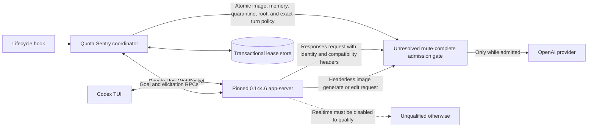

The admission gate is the enforcement boundary. Once closure is acknowledged,
every later model request for the eligible root or a non-exempt descendant must
wait outside model inference and continue automatically after the gate
reopens. Exact `0.144.6` skips start hooks for Review, Guardian, and other
constructible non-`ThreadSpawn` `SubAgent` workers; those requests inherit the
root `session-id` while using distinct `thread-id` values. Although the source
enum contains `Compact`, this version has no production constructor for that
descendant; manual compaction is a same-thread `/responses/compact` operation.
A root-session policy
must therefore catch unknown descendants. Elicitation keeps code-mode results
from entering a visible wait loop; Goal pause prevents idle Goal wakeups.
Neither is global enforcement on its own.

V2 `followup_task` adds a separate hookless first-request path. It can reload
an evicted child with `InitialHistory::Resumed`, submit triggering
`InterAgentCommunication`, skip `SubagentStart` and `UserPromptSubmit`, and
reach sampling without `PreCompact` when below threshold. Root-session closure
holds the child. The request metadata does not contain exact current CWD, so a
hookless resumed turn cannot prove directory exemption. Quota Sentry preserves
resumable identity across stop/eviction and inventories stored descendants
without retaining their prior eligibility. Provider admission verifies identity
but keeps the request held unless same-turn hook CWD already exists. Runtime
notifications may warm identity state but are neither CWD evidence nor
acknowledgment barriers.

Phase-one memory extraction creates an earlier race. After root input is
submitted, Codex starts the memory pipeline asynchronously. Its one-time
rate-limit guard defaults to allowed when lookup fails, and extraction can
reach the provider before the root's first `SessionStart` or `PreCompact`.
Phase one has no memgen marker. It does send separate root `session-id` and
`thread-id` headers plus a valid structured `x-codex-turn-metadata` header with
exact `request_kind: "memory"`. The gate must parse that JSON structurally and
classify it before root/thread policy; substring matching is forbidden.

Phase-two memory consolidation is an independent hidden session. It creates a
new `SessionSource::Internal(MemoryConsolidation)` session ID, runs normal
`SessionStart`, and is hidden from normal loaded-thread lookup. It therefore
neither inherits the originating root closure nor qualifies as a root. Its
provider request carries `x-openai-memgen-request: true`.

Together those two identities form one generation-wide autonomous-memory
class. The gate must expose an idempotent, monotonically revisioned policy
containing that closed class, a generation-wide headerless-image/global-route class,
unknown-root quarantine, closed root sessions, and exact-turn permits backed
by current hooks. Evaluation order is headerless image or unknown HTTP route,
autonomous memory, an active exact-turn permit, inherited root-session closure, unknown-root
quarantine, then default open. After closure, only revisioned root-add and
inactive-then-active turn-permit CAS operations may expand policy. Neither can
reopen the root or override image or autonomous-memory classes. Neither memory
phase receives a directory or bypass permit: they are asynchronous background requests, and phase two
exposes no reliable originating-root relationship in exact `0.144.6`. An
exempt root's user work may continue while its background memory request waits
for generation release.

Image generation and editing use the active provider at HTTP
`POST /images/generations` and `POST /images/edits` with no Codex root, thread,
turn, CWD, or permit headers. The route class must therefore hold all such
requests in a blocked generation before identity policy is evaluated. The
complete qualified HTTP route set for this revision is `POST /responses`,
`POST /responses/compact`, `POST /images/generations`, and
`POST /images/edits`. Responses WebSocket is disabled. Any other provider
inference route or transport makes the session unqualified for later
generations. The HTTP gateway remains a transparent catch-all: an unexpected
route forwards while open, queues under the same conservative global-route
fallback as headerless images without denial under a closed generation, and
forwards the same request on release. Observing an unplanned route emitted by
real Codex rejects the gateway candidate, not the Codex operation; it never
silently bypasses closed policy. A deliberately labeled synthetic H12 route
injection is a fallback control: it must exercise the same behavior and mark
that test instance unqualified for later generations, but its deliberate
existence does not show that Codex's real route inventory is incomplete.

Realtime is outside that route contract. Exact `0.144.6` can start provider
inference over a standalone WebSocket or a WebRTC call plus sideband, and an
active transport cannot be parked by an HTTP gateway. A session qualifies only
when its effective configuration authoritatively disables realtime before any
gate, elicitation, or Goal mutation. A real start attempt must produce zero
upstream bytes. Otherwise Quota Sentry passes the session through visibly
unqualified and makes no protection claim.

The gate also requires readable complete state after response loss and
pending-request identity. An unknown exact thread beneath a closed root and an
ordinary request from a session absent from the root set must remain queued
before upstream connection. The latter is protected by unknown-root quarantine
until a lifecycle hook installs a root closure or exact-turn permit. It must pass healthy Codex traffic
transparently and must not make a broken or uninstalled Quota Sentry render
Codex unusable. No
mechanism meeting those requirements has yet been proven on stock `0.144.6`.

Ordinary Responses requests do not set a total request timeout, but
`/responses/compact` does: four provider stream-idle intervals, 20 minutes at
the default. A compact request that races with gate closure can therefore time
out instead of automatically resuming. The local-gateway candidate is rejected
unless isolated testing holds a compact request beyond its configured timeout
and proves the identical operation resumes without timeout or retry.

### Acquisition And Release

```mermaid
flowchart TD
    B[Authoritative blocking generation] --> R[Snapshot roots, registrations, and stored V2 descendants]
    R --> RL[Lock generation and root-session policies in canonical order]
    RL --> E[Revalidate roots, current hook-turn permits, and stored child candidates]
    E --> U[Exclude failed roots as unqualified; retain autonomous-memory class and valid roots]
    U --> P[Build atomic image and memory closures, unknown-root quarantine, root policies, and turn permits]
    P --> I[Commit admission-close intent]
    I -->|Commit fails and gate open| PRE[Return current hooks and mark unqualified]
    I -->|Committed| C[Install exact intended generation policy]
    C --> CA{Exact close success acknowledged?}
    CA -->|No or rejected| RB{Read back complete gate state}
    RB -->|Verified open| PRE
    RB -->|Exact intended generation and policy closed| CP
    RB -->|Unreadable or mismatched| X[Keep blocking hooks waiting; admission indeterminate]
    CA -->|Yes| CP{Closed acknowledgment committed?}
    CP -->|No| POST[Keep admission closed and blocking hooks waiting]
    CP -->|Yes| L[For each eligible operation acquire its lease lock]
    L --> OE{Operation still loaded, fresh, and eligible?}
    OE -->|No| UO[Leave root policy closed; record no child mutation]
    UO --> W
    OE -->|Yes| EI[Commit elicitation intent and increment once]
    EI --> PA{Increment acknowledged?}
    PA -->|No| RPCI[Keep admission closed; operation park indeterminate]
    PA -->|Yes| V[Start or verify continuous root Goal event stream]
    V --> G{Root Goal Active?}
    G -->|No| W[Wait outside model inference]
    G -->|Yes| GP[Commit pause intent and set Goal Paused]
    GP --> GB[Ordered read barrier and event attribution]
    GB -->|Owned| W
    GB -->|Uncertain| GX[Mark Goal pause mutation indeterminate and keep admission closed]
    GX --> W

    W --> Q{Authoritative release?}
    Q -->|No| W
    Q -->|Yes| GL[Lock generation and all root Goals in canonical order]
    GL --> CF[Freeze root joins, turn permits, and provider-boundary classifiers]
    CF --> GM{Every generation mutation terminal and unambiguous?}
    GM -->|No| RX[Keep admission closed; require explicit recovery]
    GM -->|Yes| ALL{Every child park held and every stopped-child drain resolved?}
    ALL -->|No| RX[Keep admission closed; require explicit recovery]
    ALL -->|Yes| D[Decrement each acknowledged elicitation exactly once]
    D --> DA{Every decrement acknowledged?}
    DA -->|No| RX
    DA -->|Yes| HR[Release waiting hooks]
    HR --> GS{Goal ownership state?}
    GS -->|Not needed or conclusively changed| GN[Leave Goal unchanged]
    GS -->|Owned and unchanged| GO[Reactivate each still-owned root Goal once]
    GS -->|Indeterminate| RX
    GO --> GA{Every Goal barrier resolved?}
    GA -->|No| RX
    GA -->|Yes| O[Open complete generation policy, including image and memory classes, as final action]
    GN --> O
    O --> OA{Open read back and acknowledged?}
    OA -->|No| RX
    OA -->|Yes| C2[Pending original work continues automatically]

    HH[Qualified root hook or identity-bearing child hook observes block] --> ID{Payload carries agent_id?}
    ID -->|No| RQ{Root already in this policy revision?}
    RQ -->|No| RJI[Commit root-join intent under generation lock]
    RJI --> RT{Payload carries turn_id?}
    RT -->|No, root SessionStart| RSU{Unbound CWD is eligible?}
    RSU -->|Yes| RJA
    RSU -->|No, exempt or bypassed| RH[Retain unknown-root quarantine]
    RT -->|Yes| RJC{Eligible root or exempt current turn?}
    RJC -->|Eligible| RJA[CAS-add root closure and verify readback]
    RJC -->|Exempt| RJP[Stage and activate exact-turn permit]
    RJA --> PR[Prioritize eligible operation]
    RJP --> RET[Return after active permit acknowledgment]
    RH --> RETQ[Return after exact quarantine acknowledgment]
    RQ -->|Yes| RR[Refresh root identity; bind turn evidence only when turn_id exists]
    ID -->|Yes| CR[Verify thread identity and create or merge one child registration]
    CR --> CE{Child exempt or bypassed?}
    CE -->|Yes| XO[Stage and activate exact-turn permit before returning]
    CE -->|No| PR[Prioritize eligible child operation]
    RR --> PR
    PR --> L

    UQ[Unknown exact thread request reaches a closed root] --> PH[Queue request before upstream connection]
    PH --> VR[Verify with thread/read includeTurns true under generation lock]
    VR --> VC{Loaded ThreadSpawn in same root and policy epoch?}
    VC -->|No or unavailable| IH[Retain inherited root hold; never deny]
    VC -->|Yes| UR[Create or merge provider-boundary registration]
    UR --> PX{Matching current-turn hook CWD proves exemption?}
    PX -->|No or unavailable| AO[Record admission-only participant and retain root hold]
    PX -->|Yes| XI[CAS-add inactive exact-turn permit]
    XI --> XA{Inactive permit read back and durable?}
    XA -->|No| IH
    XA -->|Yes| ACT[Commit activation intent and activate exact turn]
    ACT --> FW[Forward same queued request while root stays closed]

    NQ[Ordinary request has no root or turn rule] --> NPH[Queue under unknown-root quarantine]
    NPH --> NR[Await matching root hook and generation-locked join]
    NR -->|Root closure| IH2[Retain root hold]
    NR -->|Exact-turn permit| FW2[Forward only matching turn]
    NR -->|Release wins| FW3[Forward after authoritative open]
```

A root Goal is never reactivated while one associated child park remains held
or indeterminate. Every admission, root-join, classifier, permit, elicitation,
stopped-child drain, and Goal intent/result is a generation mutation; release
requires every one to be terminal and unambiguous. Successfully released hook
processes are not rolled back, but provider admission remains closed until
every operation park and Goal in the generation is resolved. An
already-upstream provider request is allowed to finish; the measurable promise
begins at admission-close acknowledgment.

Admission-only participants have no elicitation decrement. Release freezes
root joins, turn permits, and classifiers under the same generation lock;
unresolved work is cancelled while exact HTTP requests remain queued. Opening
the complete generation policy as the final action resumes those same requests.
A late resolver cannot write a root or permit into an open or later generation.

The root-session policy catches hookless `SubAgent` descendants. Every
installed child hook carrying `agent_id` first performs the same verified,
idempotent child upsert. A registered exempt child receives an exact-turn
permit only from that hook's canonical CWD and turn ID, after staging,
activation, and readback are durable. An eligible child joins the root
generation and park. A hookless `SubAgent` child cannot establish a permit and
inherits root closure.

An evicted V2 child does not necessarily execute one of those hooks. Known
resumable descendants retain durable identity but no current-CWD authorization.
An unindexed or racing request is the first enforceable boundary: the gate
queues it and the coordinator verifies identity, but without same-turn hook CWD
it retains the inherited hold even if stored CWD was exempt. No classification
failure becomes a denial; the same request remains queued until quota release.
`SubagentStop` invalidates current-turn eligibility and retires its permit. Any
uncertain stale permit remains bound to the old unique turn ID and cannot
authorize a reload. If the child has an acknowledged park, Quota Sentry does
not voluntarily complete the stop hook successfully: it keeps the active turn
and loaded `CodexThread` alive, commits a decrement intent, decrements that
exact elicitation once, persists the acknowledgment, and only then marks the
park `stopped_drained` and returns success. A Codex-forced timeout is failed
participant loss, not a safe return. A lost decrement response, store failure,
timeout, or unload is indeterminate and keeps admission closed.

The unknown-root quarantine covers roots that begin after closure. Their first
root lifecycle hook supplies current CWD, but root `SessionStart` supplies no
turn ID. Under the generation lock, an eligible root may be conservatively
CAS-added to the root set from that unbound CWD. An exempt or bypassed
`SessionStart` receives no permit and remains quarantined until a later
turn-ID-bearing root hook establishes exact CWD/turn evidence or release opens
the generation. A turn-scoped hook may activate only its exact-turn permit.
Release uses the same lock: join-first is included in the frozen release
snapshot; release-first forbids mutation and the request continues only after
open acknowledgment. Lost responses require complete policy-revision readback.

The autonomous-memory class, headerless-image/global-route class, and unknown-root
quarantine close for every confirmed-block generation even when no root
qualifies. Phase-one extraction matches structured `request_kind: "memory"`;
phase-two consolidation matches the memgen marker. Image generation and editing
match by route before identity policy.
A failed root revalidation excludes only that root from Goal or elicitation
mutation; its ordinary request remains quarantined. It cannot suppress either
memory classifier or another valid root's closure.

A rejected, missing, or lost close response always triggers readback under the
same admission lock. Verified open means no protection was established, so
current hooks return successfully, affected registrations become unqualified,
and no elicitation or Goal mutation follows. The exact intended gate epoch,
generation, image and autonomous-memory classifier sets, quarantine state,
root set, turn-permit set, and policy revision read back closed is a
recovered close acknowledgment; acquisition advances only after it commits.
If that commit fails, blocking hooks wait with admission closed. An unavailable
readback or any mismatched closed policy is indeterminate: blocking hooks wait,
including `SubagentStop` when it owns an acknowledged or indeterminate park,
and no later external mutation is issued.

### Stopped-Child Drain

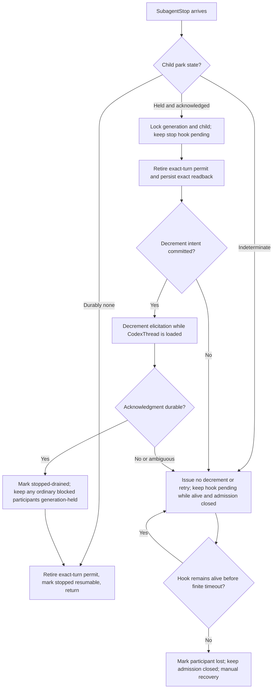

The elicitation count belongs to the loaded `CodexThread`; a durable Quota
Sentry row cannot reconstruct it after V2 residency removes that thread. During
a healthy held-and-acknowledged drain, the pending stop hook keeps the child
loaded and non-evictable. Exact `0.144.6` applies a finite command-hook timeout,
kills the hook process on expiry, and returns a failed hook result; Quota Sentry
cannot claim the hook or loaded child survives beyond it. Qualification
therefore requires the healthy drain to complete comfortably before timeout.
An indeterminate park is never decremented or retried. Timeout, hook death,
forced unload, or a lost decrement outcome keeps the generation mutation
nonterminal and admission closed for explicit manual recovery.

### Goal Ownership

The public Goal object omits the internal Goal ID and exposes whole-second
timestamps. A matching snapshot cannot detect a quick
`Paused -> Active -> Paused` mutation. Quota Sentry must subscribe to ordered
`thread/goal/updated` and `thread/goal/cleared` events before its initial read,
attribute its own expected mutation, and retain continuity through release.

An external mutation continuously observed and attributable after acknowledged
ownership becomes terminal `changed`; Quota Sentry leaves that Goal untouched.
An unattributable event, connection gap, reconnect, runtime-epoch change, or
snapshot mismatch without an observed external mutation is not `changed`. It
becomes nonterminal `pause_indeterminate` during acquisition or
`release_indeterminate` afterward and keeps complete admission closed. Even on
a continuous stream, the healthy-path guarantee excludes external Goal
mutation throughout the entire ownership interval because `0.144.6` has no
compare-and-set Goal revision.

That conclusively changed state is distinct from an uncertain initial pause.
`not_needed` is terminal only when durable history proves no pause RPC was
sent; `changed` is terminal only after an acknowledged owned pause followed by
an observed external mutation. A lost pause response, failed ownership commit,
ambiguous ordered read barrier, or event gap during acquisition is
`pause_indeterminate`. A later continuity loss, reconnect, unattributable event,
runtime-epoch change, snapshot mismatch, or failed activation barrier is
`release_indeterminate`. Both remain nonterminal generation mutations and
prevent admission from opening even if a later public snapshot appears
`Paused` or `Active`.

### Eligibility And Experimental API

Each root and child registration stores operation/root IDs, parent, optional
last hook turn and canonical CWD evidence, evidence kind, stored diagnostic
CWD, bypass/exemption and policy generation, runtime epoch, origin,
resumability, heartbeat, lifecycle, and turn-scoped eligibility. In exact
`0.144.6`, turn-scoped hooks serialize current `TurnContext.cwd` and turn ID.
Root `SessionStart` serializes CWD but omits `turn_id`; that unbound evidence
cannot authorize a permit. `thread/read(includeTurns: true)` may prove a loaded
non-ephemeral child's live root session identity, source, and lineage, but its
live merge retains persisted CWD and cannot authorize directory exemption. The
default metadata-only view reports persisted `sessionId == child id` and is
not live child identity evidence. Provider turn metadata also omits exact CWD;
Git workspace keys are not a substitute. `thread/resume` is not used as a read
because it subscribes the caller, replays pending requests, mutates thread
client settings, and runs idle Goal lifecycle handling.

`SessionStart` normally registers a root with `session_start_unbound` CWD. It
may support conservative root closure but never a turn permit. Exact `0.144.6`
does not provide an atomic external correlation from its internal hook-run
turn ID to command stdin and the queued provider request, so Quota Sentry does
not reconstruct the missing field. The same version can run pre-sampling
compaction first, so a turn-ID-bearing `PreCompact`
without a registration may bootstrap only a verified `session_id` root.
`UserPromptSubmit`, `PreToolUse`, and `PostToolUse` may likewise refresh a root
with exact-turn evidence. Missing `agent_id` is insufficient because
non-`ThreadSpawn` `SubAgent` hooks omit it too. Under the lock, `thread/read`
must prove `thread.id == thread.sessionId == session_id`, no parent,
non-internal source, and loaded status. A permit binds `thread_id = session_id`;
if an unlabelled internal child emitted the hook, that key cannot match the
child provider request. Current CWD/turn comes from the same turn-scoped hook.
Later lifecycle hooks merge idempotently. A `PreCompact` carrying `agent_id`
cannot bootstrap a root.

No hook exclusively owns child creation. Every installed identity-bearing
child hook (`SubagentStart`, `UserPromptSubmit`, `PreToolUse`, `PostToolUse`,
or `PreCompact`) acquires the child-registration lock and uses
`thread/read(includeTurns: true)` to prove that `thread.id == agent_id`, its
live `thread.sessionId == session_id`, the thread is loaded and non-ephemeral,
its source is `SessionSource::SubAgent(ThreadSpawn)`, and its persisted
parent/session relationship is consistent. Default, ephemeral, unavailable,
or malformed reads cannot create a permit. Identity, source, and parent come
from that qualified runtime record; current CWD/turn comes from the hook. The
hook atomically creates or merges one registration and evaluates bypass,
exemption, and policy generation for that exact turn.

This covers hook-visible ordering gaps, but not every V2 resume. A child
awakened through `followup_task` can sample on hookless
`InterAgentCommunication` below threshold. V2 registrations therefore remain
`stopped_resumable` or `unloaded_resumable` across `SubagentStop`, completion,
and eviction, but current-CWD eligibility does not. `SubagentStop` invalidates
the turn classification and retires its permit. With durable proof of no park,
it may mark the child resumable and return. A held-and-acknowledged park is
decremented exactly once while loaded and permits return only after durable
acknowledgment. An indeterminate park is never decremented or retried; the hook
remains pending only until its finite timeout or loss, after which admission
stays closed for explicit recovery. A lost cleanup leaves only an old
unique-turn permit that cannot match a reload, but a lost park drain also keeps
the generation closed. Before root closure,
paginated `thread/list(ancestorThreadId=root,
sourceKinds=[subAgentThreadSpawn])` inventory across archived and nonarchived
partitions verifies identity, ancestry, and source but never authorizes a
permit from stored CWD or former exemption. A hookless resumed child has no
safe live-CWD source in stock `0.144.6`; it remains held until generation
release. Supporting its directory exemption requires a future read-only
live-config RPC, authenticated current-CWD provider field, or Codex fork.

Inventory cannot close a snapshot/reload race. A request under a closed root
with a different `thread-id` and no exact rule is queued as
`classification_pending` before any upstream connection. Under generation and
child locks, the coordinator uses `thread/read(includeTurns: true)` on the
owning app-server to verify a loaded non-ephemeral `ThreadSpawn` in the same
root and policy epoch. Eligible or identity-only children become admission-only
participants and retain the root hold. Only matching current-turn hook CWD may
stage an inactive exact-turn permit; durable staged readback and activation
intent precede active readback and forwarding.
Unsupported, unavailable, or indeterminate resolution keeps the request held
without denial until release. Pending records use provider request,
session/thread/turn, runtime/gate epoch, generation, current hook evidence if
any, policy revision, and `classification_pending`, `eligible_held`,
`permit_staging`, `permit_staged`, `activation_pending`, `permit_active`,
`released`, or `indeterminate`.

This registry does not enumerate hookless non-`ThreadSpawn` `SubAgent`
descendants because exact `0.144.6` skips their start hooks. Their inherited
root `session-id` is the admission key. A permit is exact by gate epoch, quota
generation, session, thread, turn, and policy generation; an unknown descendant
has no permit.

Phase-one extraction has no independent lifecycle registration requirement.
Its provider request is classified by structured `request_kind: "memory"`
before any root/thread rule. The independent phase-two worker runs
`SessionStart`, but normal loaded-thread lookup hides it. Qualification fails
and that hook returns unqualified without a root lease or turn permit. Its
memgen-marked request remains subject to the autonomous-memory closure.

Immediately before admission closure, root-add, turn-permit mutation, or any
app-server mutation, the coordinator revalidates runtime, exact hook turn/CWD
evidence when required, bypass evidence, policy generation, freshness, request
identity, and expected policy revision while holding the relevant locks.
Failure before closure means no proactive mutation and no hook denial. Failure
after a request inherits a closed root or unknown-root quarantine keeps it
queued; it does not invent a permit. Once an eligible confirmed block is
acquired, ordinary CWD changes do not silently release it.

Every Quota Sentry app-server connection must initialize with
`capabilities.experimentalApi: true`. Installation qualification uses a
disposable loaded probe thread, verifies one elicitation increment from count
0 to 1 and one decrement back to 0, then removes the probe. A user thread is
never used for this test.

### Durable Failure Rules

The lease database is a correctness boundary. Startup verifies permissions,
database identity, schema/migration state, and `PRAGMA quick_check`; it never
silently recreates a missing or corrupt store. Every external mutation has a
transactionally committed intent containing runtime/gate epoch, quota
generation, operation identity, and request or idempotency ID.

| Store or runtime event | Required outcome |
| --- | --- |
| Intent commit fails before admission closure and gate is read back open | Do not send the mutation; every current hook returns success; mark the session unqualified and continue unprotected. |
| Close is explicitly rejected or its response is lost; readback verifies open | Return every current hook successfully, mark affected registrations unqualified, and send no app-server mutation. |
| Close is explicitly rejected or its response is lost; readback verifies the exact intended policy closed | Persist the recovered close acknowledgment before continuing without resending close. If that commit fails, keep blocking hooks waiting and issue no app-server mutation. |
| Gate readback is unavailable or reports a different epoch, generation, image or autonomous-memory classifier set, quarantine state, root set, turn-permit set, or policy revision | Keep blocking hooks waiting, mark admission indeterminate, and issue no later mutation. `SubagentStop` also remains pending while its finite hook is alive whenever a child park is acknowledged or indeterminate; timeout marks it lost without opening admission. |
| Store commit fails after admission closure | Send no later mutation; keep the complete generation policy closed and blocking hooks waiting. `SubagentStop` also waits while its finite hook is alive whenever returning could strand a child park; timeout marks it lost and requires manual recovery. |
| Mutation is acknowledged but acknowledgment cannot be persisted | Stop the generation, retain closed admission, and mark it indeterminate. |
| Closed-generation root-join intent cannot commit | Return the root hook only after exact quarantine coverage is durably read back; otherwise wait. Keep the ordinary request quarantined and make no Goal/elicitation claim. |
| Root-add response is lost or acknowledgment cannot commit | Read back the exact policy revision. A present root is recovered, an absent root stays quarantined, and mismatch is indeterminate. Release cannot pass an indeterminate join. |
| Provider-boundary classification intent cannot commit under an already-closed root | Keep the same exact request queued under inherited root closure; create no permit and send no app-server mutation. Retry after store recovery or release it with authoritative generation open. |
| Inactive turn-permit response is lost | Read back the exact generation policy. Persist exact inactive staging before activation; otherwise keep the request held. |
| Turn-permit activation or revocation is indeterminate | Inactive/absent remains held. Exactly active may forward only with prior durable activation intent, and automatic teardown waits for recovery. A later turn can never match the old permit. |
| Held-and-acknowledged stopped-child decrement intent cannot commit before the call | Send no decrement. Retry only the local intent commit while the finite hook and exact loaded thread remain alive; timeout or loss ends that guarantee. Keep admission closed and retain a nonterminal generation mutation. |
| A stopped-child decrement may have been sent but its response/acknowledgment is indeterminate | Do not retry or compensate. Keep `SubagentStop` pending only while the finite hook remains alive; timeout or loss ends the loading guarantee. Keep admission closed for explicit recovery. |
| `SubagentStop` observes an indeterminate park | Never decrement or retry it. Keep the hook pending only while its finite process remains alive; timeout or hook loss requires explicit recovery with admission still closed. |
| Initial Goal pause response, ownership commit, ordered barrier, or event attribution is indeterminate | Keep admission closed and retain a nonterminal generation mutation. Never relabel the Goal unowned from a later public snapshot. |
| Store is missing, corrupt, or migration-failed at startup and gate is closed | Keep the reported gate closed; perform no app-server mutation; require explicit recovery. |
| Store is unusable and gate is open with no provable latch | Continue as visibly unqualified; do not invent a block. |
| Mutating RPC may have been sent before disconnect | Do not retry, compensate, decrement speculatively, or claim auto-resume. |
| An attributable external Goal mutation is observed after acknowledged ownership | Record terminal `changed`, leave the Goal untouched, and resolve parks only through the generation release barrier. |
| App-server epoch changes, Goal event continuity is lost, an event is unattributable, or a Goal barrier fails | Record `pause_indeterminate` during acquisition or `release_indeterminate` afterward; leave the Goal untouched and keep complete admission closed. |

Restarting app-server, discarding the lease database, or forcing an admission
gate open is an explicit user recovery operation. Install, startup, and hooks
must never do it automatically.

Returning before closure is required because one waiting hook cannot protect
hookless or model-progress paths and would falsely resemble a global park.
Waiting after closure is required because admission is already globally held;
returning a hook cannot safely restore the pending operation while durable
ownership is unresolved. Neither branch emits a denial.

### Revision 4 State Matrix

| Effective evidence | Retained block? | Coordinator/boundary action | Provider/model outcome | Goal outcome |
| --- | --- | --- | --- | --- |
| Fresh authoritative open | No | Return success | Admission open; continue | Unchanged |
| Newer authoritative matching release | Yes | Run generation release barrier | Open admission last | Reactivate only continuously owned unchanged Goal |
| Stale open | No | Request asynchronous refresh and return | Continue unprotected; no denial | Unchanged |
| Unknown, fresh or stale | No | Request asynchronous refresh and return | Continue unprotected; no denial | Unchanged |
| Missing cache or source observation | No | Request asynchronous refresh and return | Continue unprotected; report health out of band | Unchanged |
| Malformed cache or source observation | No | Request asynchronous refresh and return | Continue unprotected; report health out of band | Unchanged |
| Confirmed threshold or backend block | New or retained | Revalidate roots, inventory resumable V2 descendants, and atomically close headerless images, autonomous memory, unknown-root quarantine, eligible roots, and current-hook turn permits; then acquire/join parks | No later ordinary unpermitted, image, phase-one memory, or phase-two memory request admitted after close acknowledgment | Pause active root once after closure |
| Root-registration `PreCompact` before `SessionStart` | Current quota state | Prove root identity from app-server metadata, use hook CWD/turn for eligibility, and create/qualify the missing registration | On block, an eligible root closes/joins and waits before compact; an exempt current turn returns only after permit activation; otherwise continue | Pause only through normal generation acquisition |
| Phase-one memory request races root registration | Generation block | Structurally parse `x-codex-turn-metadata`; exact `request_kind: "memory"` matches the autonomous-memory class without relying on root registration or Codex's guard | Hold extraction even when the guard lookup failed open; release with the generation | No Goal mutation for the background request |
| Phase-two memory-consolidation `SessionStart` | Either | Loaded-thread qualification fails; return unqualified without a root lease or permit | Its later marked request is evaluated by the autonomous-memory rule | No Goal mutation for the hidden worker |
| Hookless inherited `SubAgent` descendant of a closed root | Inherited from root | No hook registration or child mutation | Hold Review, Guardian, or other constructible non-`ThreadSpawn` request by inherited `session-id`; manual compact is governed as same-thread `/responses/compact` | Root Goal pause remains shared |
| Phase-two request marked `x-openai-memgen-request: true` during a confirmed or retained block | Generation block | Match the autonomous-memory closure before thread/session rules; no root registration is required | Hold the independent memory request until generation release | No Goal ownership invented |
| Headerless `POST /images/generations` or `POST /images/edits` during a confirmed or retained block | Generation block | Match the route before identity rules; no root, CWD, bypass, or turn permit applies | Hold the same image request until complete generation release | No Goal ownership invented |
| Emergent unexpected HTTP provider route emitted by real Codex | Either | Apply the global-route fallback and mark gateway qualification failed for later generations | Forward transparently while open; while blocked, queue and resume the same request at release | No Goal mutation |
| Effective configuration can start realtime WebSocket or WebRTC inference | Either | Mark the session unqualified before gate, elicitation, or Goal mutation | Continue transparently without a Quota Sentry protection claim | Unchanged |
| Realtime start attempted in a qualified session | Either | Authoritative feature disablement prevents transport creation; any upstream byte fails qualification | Zero upstream realtime traffic | Unchanged |
| Hook-visible `ThreadSpawn` child first appears at an identity-bearing hook | Root state | Verify live identity with `thread/read(includeTurns: true)`, classify only from hook CWD/turn, and create or merge one child registration | Eligible child inherits closure and parks; exempt child receives a durable active exact-turn permit | Root Goal remains shared; no child Goal ownership invented |
| Stored resumable V2 descendant during root acquisition | New generation | Inventory by root ancestor, verify identity/ancestry/source, and treat stored CWD/exemption as diagnostic only | Unloaded child receives no permit; its first request inherits closure and triggers identity-only classification | No child Goal ownership invented |
| Evicted V2 child awakened by `followup_task` reaches admission with no exact rule | Root blocked | Queue before upstream and classify identity under generation lock | Hookless turn remains held regardless of prior exempt CWD and resumes on release | Shared root Goal remains paused |
| Provider-boundary lookup unavailable before permit mutation | Root blocked | Preserve pending classification without denial | Same request remains queued until release or matching same-turn hook evidence is permitted | Preserve existing root Goal ownership |
| Staged turn permit or activation indeterminate | Root blocked | Preserve inherited closure/inactive permit and require exact readback | Never forward from ambiguity; active permit requires durable activation intent and exact readback | Preserve root Goal ownership; no child Goal mutation |
| Eligible root starts after another root already closed the generation | Generation blocked | Unknown-root quarantine holds it; qualify conservatively from root hook CWD and CAS-add a root closure under generation lock. `SessionStart` needs no turn ID to close the whole root | Remain quarantined until root closure acknowledgment, then held until release | Mutate Goal only after durable root-add acknowledgment |
| Exempt root first appears through post-close `SessionStart` | Generation blocked | Record unbound CWD and retain unknown-root quarantine; create no permit | Remain queued until a matching later turn-scoped hook activates a permit or release opens admission | No Goal mutation |
| Exempt root reaches a post-close turn-scoped hook | Generation blocked | Match provider session/thread/turn, then stage and activate one exact-turn permit | Only the exact evidenced turn proceeds; later turns require new evidence | No Goal mutation |
| Stale or unknown observation | Yes | Preserve latch, admission, and parks | Remain held | Preserve owned pause |
| Missing or malformed observation | Yes, durable store readable | Preserve latch, admission, and parks | Remain held | Preserve owned pause |
| Reset estimate passed without authoritative clear | Yes | Preserve and request immediate refresh | Remain held | Preserve owned pause |
| Exempt or bypassed before acquisition | Either | Persist exact hook-turn evidence; under a closed generation require exact-turn permit acknowledgment | Exact ordinary turn remains open; autonomous memory and headerless images remain governed by generation classes | Unchanged |
| Registered or dynamically verified exempt child under a closed root | Root blocked | Wait until its active exact-turn permit is durable and acknowledged | Only that turn continues; root and other turns/descendants remain held | Unchanged by permit |
| Embedded or otherwise unreachable session | Either | Do not proactively mutate; report unqualified | Continue without protection only outside the qualified gate; a request reaching a blocked generation is quarantined | Unchanged |
| Store intent fails before closure and gate is verified open | Either | Return every current hook; mark unqualified | Continue unprotected; do not claim a park | No mutation sent |
| Close rejected or response lost; readback verifies open | Yes | Return every current hook; mark affected registrations unqualified | Continue unprotected; do not claim a park | No mutation sent |
| Close rejected or response lost; readback verifies exact intended policy closed and acknowledgment commits | Yes | Continue ordinary blocked-event handling without resending close | Remain held by the recovered generation policy | Pause only after durable recovery |
| Exact intended policy is closed but acknowledgment commit fails | Yes | Keep blocking hooks waiting; `SubagentStop` with an acknowledged or indeterminate park waits only while its finite hook remains alive, then becomes lost | Keep complete generation policy closed | Send no Goal mutation |
| Close readback unavailable or closed policy mismatched | Yes | Keep blocking hooks waiting; `SubagentStop` with an acknowledged or indeterminate park waits only while alive, then becomes lost; mark indeterminate | Do not claim pass-through or protection | Send no Goal mutation |
| Store commit fails after closure | Yes | Keep blocking hooks waiting; `SubagentStop` waits only while alive whenever returning could strand a park, then becomes lost | Keep complete generation policy closed | Send no later mutation |
| Initial Goal pause response, barrier, event attribution, or acknowledgment is indeterminate | Yes | Retain a nonterminal generation mutation and require explicit recovery | Keep admission closed regardless of later public Goal state | Never classify it as unowned or reactivate it |
| Mutation or post-ack store state indeterminate | Yes | Keep admission closed; explicit recovery | Preservation or release cannot be claimed | Never retry or blindly activate |
| Hook dies or app-server epoch changes | Yes | Record loss; stop automatic release | In-flight preservation cannot be claimed | Never infer old state |
| Explicit disable/uninstall, all state unambiguous | Override | Run generation barrier before teardown | Open admission last; drain/handoff pending requests | Restore only continuously owned unchanged Goal |
| Explicit disable/uninstall, any state indeterminate | Override | Abort teardown; present manual recovery | Preserve observed closed or indeterminate policy | Never blindly activate |

The retained missing/malformed rows apply only while the durable latch is still
readable. If the lease database itself is missing or corrupt, the durable
failure rules apply.

### Revision 4 Lifecycle And Admission Matrix

| Boundary event | Fresh open | Unlatched stale, unknown, missing, or malformed | Confirmed or retained block | Denial |
| --- | --- | --- | --- | --- |
| Root `SessionStart` | Register identity and unbound hook CWD; create no permit; return | Register unbound CWD, request refresh; return | Eligible CWD may root-add; exempt/bypassed CWD remains quarantined with no permit. Return only after exact root closure or durable quarantine coverage | Never |
| Internal memory `SessionStart` | Fail loaded-thread qualification; return unqualified | Fail qualification, request refresh; return unqualified | Return unqualified; the marked provider request remains held by the autonomous-memory closure | Never |
| `SubagentStart` | Verify identity and create/merge from hook CWD/turn; return | Create/merge, request refresh; return | Eligible child joins and waits; exempt current turn returns after active permit acknowledgment | Never |
| `UserPromptSubmit` | Create/merge from hook CWD/turn when `agent_id` exists; otherwise refresh root; return | Create/merge or refresh, request refresh; return | Exempt current turn returns after permit acknowledgment; otherwise acquire/join and wait | Never |
| `PreToolUse` | Create/merge from hook CWD/turn when `agent_id` exists; otherwise refresh root; return | Create/merge or refresh, request refresh; return | Exempt current turn returns after permit acknowledgment; otherwise acquire/join and wait before execution | Never |
| `PostToolUse` | Create/merge from hook CWD/turn when `agent_id` exists; otherwise refresh root; return | Create/merge or refresh, request refresh; return | Exempt current turn returns after permit acknowledgment; otherwise acquire/join and wait before delivery | Never |
| Root-registration `PreCompact` | Verify root identity and create/refresh from hook CWD/turn; return | Create/refresh, request refresh; return | Join initial closure or perform root-add/permit; eligible root acquires/joins and waits before compact | Never |
| Subagent `PreCompact` | Verify identity and create/merge from hook CWD/turn; return | Create/merge, request refresh; return | Exempt current turn returns after permit acknowledgment; otherwise acquire/join and wait before compact | Never |
| `SubagentStop` | Invalidate turn eligibility, retire permit, mark resumable; return | Invalidate/retire, mark resumable, request refresh; return | Retire current-turn authorization. With durable proof of no park, mark resumable and return. For a held-and-acknowledged park, decrement exactly once while loaded and return only after durable acknowledgment. For an indeterminate park or drain, never decrement or retry; keep admission closed and the hook pending only until finite timeout or loss forces manual recovery | Never |
| Provider request for exact child with no rule | Forward; optional observation is asynchronous | Forward and request refresh | Queue before upstream; only matching current-turn hook evidence may activate a permit, otherwise retain hold | Never |
| Provider request for session absent from closed root set | Forward | Forward and request refresh | Queue under unknown-root quarantine until root-add, exact-turn permit, or release | Never |
| Headerless image generate/edit request | Forward through transparent route-complete proxy | Forward and request quota refresh | Queue by generation-wide image route class; no identity permit overrides it | Never |
| Emergent unexpected HTTP provider route emitted by real Codex | Forward transparently and mark gateway qualification failed | Forward, request refresh, and mark qualification failed | Queue by global-route fallback until release; never synthesize an error | Never |
| Realtime inference start | Qualify only when authoritatively disabled; otherwise pass through unqualified | Same as fresh open | No qualified session can create the transport; any upstream byte fails qualification | No Quota Sentry hook denial |

Failed generic tool results can skip `PostToolUse`, and ToolSearch has no
lifecycle payload. Text-only and idle-Goal continuations can also progress
without a hook. The provider-admission gate, not this hook matrix, must stop
those requests. Phase-one memory extraction likewise has no lifecycle hook at
its provider boundary; only the structured autonomous-memory classifier closes
that first-turn race. A V2 `followup_task` turn can also reach sampling with no
hook; the provider-request row is its mandatory boundary.

### Admission-Close Outcome Matrix

Every row begins with authoritative blocking evidence. "Exact intended closed"
means readback matches the locked gate epoch, quota generation, both
autonomous-memory classifiers, the headerless-image/global-route classifier, unknown-root
quarantine, complete root set, exact-turn permit set, and policy revision.

| Boundary event | Close rejected/lost; readback open | Exact intended closed and acknowledgment durable | Exact intended closed but acknowledgment commit fails | Readback unavailable or mismatched closed | Denial |
| --- | --- | --- | --- | --- | --- |
| Root `SessionStart` | Return; mark root unqualified | Register unbound CWD; return after eligible root-add or durable quarantine coverage. Never create an exact-turn permit from this payload | Wait with admission closed | Wait indeterminate | Never |
| Internal memory `SessionStart` | Return unqualified | Return unqualified; autonomous-memory policy remains closed | Wait because the autonomous-memory policy is closed but not durable | Wait indeterminate | Never |
| `SubagentStart` | Return; mark child unqualified | Create/merge, then acquire/join and wait; exempt turn waits only for active permit | Wait with admission closed | Wait indeterminate | Never |
| `UserPromptSubmit` | Return and continue unprotected | Create/merge if needed; exempt turn returns after permit acknowledgment, otherwise waits | Wait with admission closed | Wait indeterminate | Never |
| `PreToolUse` | Return and permit execution unprotected | Create/merge if needed; exempt turn returns after permit acknowledgment, otherwise waits before execution | Wait with admission closed | Wait indeterminate | Never |
| `PostToolUse` | Return and permit delivery unprotected | Create/merge if needed; exempt turn returns after permit acknowledgment, otherwise waits before delivery | Wait with admission closed | Wait indeterminate | Never |
| Root-registration `PreCompact` | Return and permit compaction unprotected; retain unqualified registration | Create/merge verified root registration; an exempt current turn returns after active permit acknowledgment, while an eligible turn acquires/joins and waits before compaction | Wait with admission closed | Wait indeterminate | Never |
| Subagent `PreCompact` | Return and permit compaction unprotected | Create/merge if needed; exempt turn returns after permit acknowledgment, otherwise waits | Wait with admission closed | Wait indeterminate | Never |
| `SubagentStop` | Invalidate turn, retire permit, mark resumable; return | Retire current-turn permit. With durable proof of no park, mark resumable and return. With a held-and-acknowledged park, keep the hook pending until its one decrement is durable, then mark stopped-drained and return. Never decrement an indeterminate park | With an acknowledged or indeterminate park, keep the hook pending while alive and admission closed; with durable proof of no park, return only after old-turn authorization is retired | With an acknowledged or indeterminate park, keep the hook pending while alive and generation indeterminate; timeout marks it lost and requires manual recovery | Never |
| Unknown exact-thread provider request | Forward because root closure was not established | Queue identity; only active permit backed by matching current-turn hook evidence may forward | Keep queued under inherited root/inactive permit | Keep queued and mark indeterminate | Never |
| Unknown-root provider request | Forward because no blocked generation exists | Queue under exact quarantine; root-add or turn permit may resolve | Keep queued under quarantine | Keep queued and mark indeterminate | Never |
| Headerless image generate/edit request | Forward because no generation policy closed | Queue under closed image route class | Keep queued under closed image route class | Keep queued; never fall through to identity rules | Never |
| Emergent unexpected HTTP provider route emitted by real Codex | Forward and mark gateway qualification failed | Queue under closed global-route fallback | Keep queued under closed fallback | Keep queued; never reject or silently forward | Never |

### Store-Failure Lifecycle Matrix

The specific closed-generation root-join row overrides the generic
`SessionStart` row only when no root or permit mutation was sent and unchanged
quarantine coverage has been durably read back. In every other post-closure
store failure, the generic wait applies.

| Boundary event | Intent commit fails before closure and gate is verified open | Store commit fails after closure | Denial |
| --- | --- | --- | --- |
| `SessionStart` | Return; mark root unqualified | Wait while admission remains closed, except for the narrower verified-quarantine root-join case below | Never |
| `SubagentStart` | Return; mark child unqualified | Wait; an exempt turn also waits for active durable permit | Never |
| `UserPromptSubmit` | Return and continue unprotected | Wait while admission remains closed | Never |
| `PreToolUse` | Return and permit execution unprotected | Wait before execution | Never |
| `PostToolUse` | Return and permit result delivery unprotected | Wait before result delivery | Never |
| `PreCompact` | Return and permit compaction unprotected | Wait before the compact HTTP request | Never |
| `SubagentStop` | Return only with durable proof that no acknowledged or indeterminate park exists; record best-effort diagnostics | With durable proof of no park, return only after old-turn authorization cannot match. For a held-and-acknowledged park, keep the hook pending and child loaded until the one decrement is durable. For an indeterminate park or drain, issue no mutation; timeout or hook loss ends the pending/loading guarantee but keeps admission closed for manual recovery | Never |
| Closed-generation root join | Not applicable before closure | Keep request quarantined; create no uncommitted root/permit. Return hook only with durable quarantine coverage, otherwise wait | Never |
| Provider-boundary child classification | While root is open, forward without synchronous classification | Keep request queued under inherited closure or inactive permit; create no uncommitted active permit | Never |

A compact request can race after `PreCompact` returns but before it reaches an
admission policy that has just closed. Holding `/responses/compact` for more
than four configured stream-idle intervals makes exact `0.144.6` time out. The
gateway candidate fails qualification unless the identical operation survives
and resumes after a longer isolated hold without retry.

H04 must begin after a tool invocation actually exists. The fake provider and
rollout independently record its fixed call ID and nonce-bearing arguments,
and a trusted `PreToolUse` hook records entry before the side effect. While the
hook waits on a short observation-only latch, the test publishes the confirmed
block and then removes that latch so the hook enters the normal Quota Sentry
path. It requires close and park acknowledgment for that exact invocation,
proves Quota Sentry still holds it with the sentinel absent, and requires the
same call to execute once after authoritative release. Closing before the model
request or holding only on the test latch is not H04 evidence.

Pre-install gateway absence is not sufficient failure evidence. After routing
is installed, qualification is complete, and policy is verified open, the
spike must terminate the socket-owning front door once while idle and once
during an independently observed ordinary request. The next or in-flight
operation respectively must complete exactly once after safe routing recovery,
without a Codex-visible error, prompt replay, duplicate upstream execution, or
user action. Failure rejects the candidate. This pre-block requirement is
distinct from front-door loss during a confirmed hold, which remains
indeterminate and cannot claim preservation.

### Post-Acquisition Disable And Uninstall

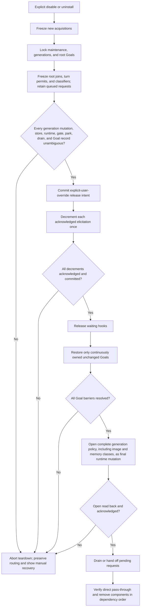

A bypass setting affects new invocations only; it never silently releases an
existing park. Automatic disable/uninstall stops before removing hooks,
provider routing, coordinator, or store if any state is indeterminate. Force
open, app-server restart, or store discard are explicit manual recovery
choices with stated loss consequences, never automatic teardown behavior.

### Notification And Approval Boundary

A running blocking hook may display exactly one concise configured
`statusMessage`:

```text
Quota Sentry: quota exhausted; waiting for reset
```

No hook stdout, stderr, feedback, or model prompt is used. However,
`statusMessage` exists only while that hook runs. In the historical Revision 4
target, a non-model TUI status for admission-only waits was a release-blocking
feasibility gate. That gate is `NOT_RUN` because compact preservation rejected
the candidate first. Exact-source review also found no qualifying external
status API, but that corroboration is not represented as a runtime gate.

The isolated feasibility spike against exact `0.144.6` passed Tasks 1-3 and
rejected the candidate at Task 4's compact-preservation gate. The following
scope is retained as the historical set of gates that the hard stop prevented
from running. The spike was intended to
prove the atomic revisioned image/autonomous-memory/quarantine/root/turn-permit
policy; the complete qualified HTTP route set and authoritative realtime
disablement; hookless
Review/Guardian/constructible-Other coverage plus same-thread manual compact; a real phase-one extraction held by
structured `request_kind: "memory"` even when the Codex guard lookup fails;
the actual independent phase-two worker held by `x-openai-memgen-request`;
root `SessionStart` persisted as unbound CWD with no permit; missing-root
registration from first `PreCompact`; verified, idempotent child registration
from first `PreCompact` for forked children using
`thread/read(includeTurns: true)`, with default and ephemeral reads held;
post-close eligible and exempt root joins in both release-race orders, including
an exempt `SessionStart` that remains quarantined until a later turn hook or
release; dormant V2 descendant
inventory; an evicted, below-threshold child awakened through real
`followup_task`, with closure synchronized after parent-tool admission and
before child-request evaluation, and no start, prompt, or compact hook;
identity-only admission holding despite opposing stored/current CWD fixtures;
same-turn permit activation from hook CWD; a healthy stop-hook-held park drain
before finite timeout and eviction plus its timeout/manual-recovery path;
reload and gate-epoch permit isolation; root-add, permit,
snapshot/reload, stopped-child drain, Goal, store, and readback failures; all
close/readback outcomes; real image holds/resume and zero-byte realtime start
attempts; preservation of the same compact request beyond four configured
stream-idle intervals; transactional disable/uninstall; qualified-open
front-door termination while idle and during a real ordinary request; a true
in-flight H04 tool call identified by call ID, arguments, and `PreToolUse`
entry; synthetic unknown-route fallback separated from emergent real-Codex
route failure; and the non-model notification boundary. A full implementation
plan remains prohibited. Further work requires a separately approved
authorized observation/supervision mechanism, such as upstream or fork
support, followed by a rerun; or a separately proposed and approved narrower
product/test contract. Neither authorizes implementation.
