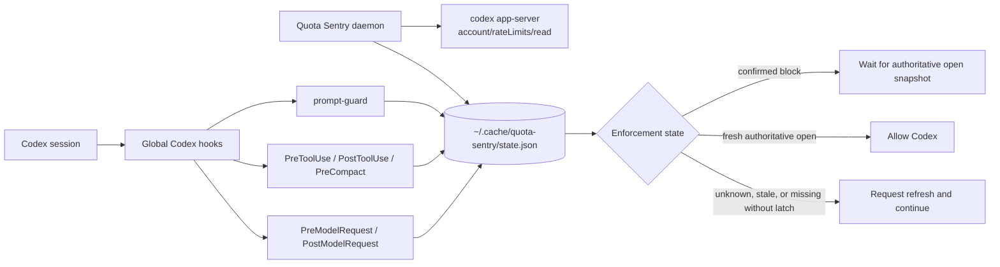

# Quota Sentry

[](LICENSE)
[](https://github.com/dhruvil009/QuotaSentry/stargazers)
[](https://www.python.org/)

> Experimental stock-Codex hook-parking candidate. This checkout adds model-request checkpoints for bounded qualification on Codex 0.168.0; it is not automatically installed in existing sessions and does not provide universal inference admission. No Codex binary modification is required. Hook lifetime, skipped hooks and uncovered internal inference remain limitations.

Quota Sentry is a local circuit breaker for Codex quota. It discovers the quota windows Codex currently exposes, guards short-term and weekly usage, and pauses new Codex activity before you burn through an enforced limit.

It is for the moment when a long agent session keeps going, your quota window is nearly spent, and the next prompt or tool call should wait instead of wasting the last few percent.

```text
Quota Sentry: 94% used
Quota Sentry: waiting for Codex quota reset until 2026-06-01T21:24:05Z.
```

## Why Use It

- Avoid accidentally exhausting a paid or rate-limited Codex window.
- Keep long-running Codex sessions from starting new work when a short-term quota is already near the threshold.
- Request recovery without rejecting unlatched work when quota data is unknown, stale, or unavailable.
- Keep a confirmed block latched until Codex reports that policy window below threshold.
- Keep hooks quiet so Codex does not flood the TUI with guard output after a long wait.

## Quick Start

Quota Sentry currently runs from this checkout. Packaging is intentionally not promised until the install path is real.

Requirements: Codex CLI, Python 3.9+, and macOS or Linux. Windows enforcement is not supported in `v0.1.x` because the daemon and state latch require POSIX process and file-locking semantics.

```bash
git clone https://github.com/dhruvil009/QuotaSentry.git
cd QuotaSentry

./scripts/quota-sentry status
./scripts/quota-sentry poll
./scripts/quota-sentry start
./scripts/quota-sentry install-hook
```

Restart every running Codex process after installing or updating hooks. Existing processes keep their previously loaded hook registry.

To bypass blocking for a session, launch or restart Codex with the variable set:

```bash
QUOTA_SENTRY_DISABLE=1 codex resume <session-id>
```

## How It Works



The daemon polls quota in the background and writes a cached decision. Codex hooks consume their JSON input immediately, then read cached state synchronously before prompts, supported tool/model boundaries and compaction. Hook paths do not invoke live quota sources; stale, unknown, or missing unlatched state requests detached recovery and returns success. A waiter that already observed a block retains that evidence even if the cache is deleted, corrupted or unreadable. A bare `status: open` is not release evidence: a fresh normalized source observation must clear the retained conditions through the same policy used by the daemon.

Once a quota block is confirmed, source failures, malformed sibling windows, stale timestamps, and an expired estimated reset time cannot clear it. Codex must report the same policy window below threshold, or the user must explicitly opt out of that policy.

## What It Watches

The `v0.1.x` line supports Codex only:

- Uses `codex app-server --stdio` by default, reading `account/rateLimits/read`.
- Treats Codex app-server as the sole authority in default `auto` mode. Source failure becomes `unknown`; it never downgrades to CodexBar to clear a latch.
- Retains explicit `--source codexbar` only as an optional compatibility and test adapter.
- Reads the canonical `rateLimits` bucket and preserves the newer `rateLimitsByLimitId` multi-bucket view when Codex provides it.
- Classifies canonical windows by duration, never by whether Codex placed them in `primary` or `secondary`.
- Treats windows up to 24 hours as short-term and begins blocking at `usedPercent >= 90`, preserving 10% of the window.
- Treats the seven-day window (`windowMinutes: 10080`) as weekly and hard-blocks at `usedPercent >= 99` by default.
- Hard-blocks explicit backend exhaustion signals such as `rateLimitReachedType` or `spendControlReached`, including responses that contain no percentage windows.
- Supports explicit advisory mode for users who want weekly status without weekly enforcement.
- Records unfamiliar long-term canonical windows and blocks them at `100%` as a schema-drift fail-safe. A durationless canonical window is `unknown` because Quota Sentry cannot safely select a policy. Auxiliary non-canonical limit IDs remain advisory when a canonical Codex bucket is also present.
- Reports missing, malformed, unavailable, or canonically ambiguous source data as `unknown`. Without a retained block, lifecycle hooks request asynchronous recovery and continue instead of denying Codex work.
- Keeps a previously confirmed block latched through stale, unknown, missing, or malformed source observations.
- Keeps recoverable hook-mode cache/config/recovery errors out of admission results: unlatched work continues, while a retained block keeps waiting. Fatal hook loss and host timeouts are not fail-safe admission barriers.
- Preserves valid blocking evidence when another returned quota window is malformed.

Codex may add, remove, or reorder quota windows. `primary` and `secondary` are retained only as source-slot metadata. For example, if Codex temporarily exposes only a weekly window in `primary`, Quota Sentry reports weekly usage and does not reinterpret it as a short-term limit.

The background daemon polls every five minutes when Codex exposes only weekly quota. The presence of any canonical short-term window reduces the baseline to one minute; near-critical usage, source recovery, and durable blocks use at most 30 seconds. Waiting hooks also re-read local state at least every 30 seconds, allowing an ad hoc reset to release without waiting for the original reset estimate.

## Commands

Run from the repository root:

```bash
./scripts/quota-sentry poll
./scripts/quota-sentry start
./scripts/quota-sentry status
./scripts/quota-sentry guard
./scripts/quota-sentry stop
./scripts/quota-sentry configure --weekly-mode advisory
```

`status` is intentionally terse for normal use:

```text
Quota Sentry: 14% used
Quota Sentry: 5h 14% used | weekly 96% used
Quota Sentry: weekly 5% used
```

It warns when the saved quota state is stale and the background daemon is not running. Use `status --verbose` to include daemon details.

Manual `guard` self-heals by polling before deciding whether to block unless it is run with `--state-only`. Installed Codex hooks use cache-only guard paths.

`guard` keeps stdout and stderr quiet by default because Codex surfaces hook output back into the TUI after long waits. When manual `guard` starts waiting, it writes one notice directly to the controlling terminal:

```text
Quota Sentry: waiting for Codex quota reset until <timestamp>.
```

Use `./scripts/quota-sentry guard --verbose` only when running it manually and you want a captured wait message too. Use `--no-notify` to suppress the terminal notice. Use `--state-only` for hook paths that must only read cached daemon state and must not invoke a live quota source. Installed Codex hooks suppress terminal notices.

Live polling accepts `--source auto`, `--source codex-app-server`, or `--source codexbar`. The default `auto` mode is an alias for the authoritative Codex app-server source and has no third-party runtime dependency.

## Weekly Policy

Weekly usage hard-blocks at `99%` by default, including when the weekly window is the only limit Codex returns or Codex places it in the `primary` source slot. No config file is required for this default. Quota Sentry records both the resolved policy and the weekly window in `state.json`.

Set a different weekly hard-block threshold or explicitly restore the default:

```bash
./scripts/quota-sentry configure --weekly-mode hard-block --weekly-threshold-percent 99
```

Opt out of weekly enforcement and retain status-only reporting:

```bash
./scripts/quota-sentry configure --weekly-mode advisory
```

When weekly usage reaches the configured threshold, Quota Sentry initially waits until the reported `resetsAt` plus the normal reset buffer. That timestamp is treated as an estimate, not release authorization: the block remains latched until a newer authoritative Codex snapshot for the same canonical limit reports weekly usage below threshold. Explicit backend exhaustion is latched independently and clears only when that same authoritative source explicitly reports the backend condition gone. Ad hoc early resets therefore release promptly, while stale data, lower-authority adapters, and source outages cannot silently reopen the guard. Missing or invalid policy configuration resolves to the safe `hard-block` default; explicit `advisory` configuration remains honored.

Daemon cadence is configurable:

```bash
./scripts/quota-sentry start --interval-seconds 300
./scripts/quota-sentry start --near-threshold-percent 85 --near-interval-seconds 60
./scripts/quota-sentry start --critical-threshold-percent 93 --critical-interval-seconds 30
```

## Install Codex Hooks

Install global Codex hooks:

```bash
./scripts/quota-sentry install-hook
```

That command serializes concurrent installers, atomically merges Quota Sentry hooks into `$CODEX_HOME/hooks.json` (or `~/.codex/hooks.json`), and writes a `.bak` backup when a hooks file already exists. It then asks Codex to trust only the exact generated hook hashes and verifies all seven hooks are enabled, trusted, synchronous and configured with the expected matchers, status and timeouts. If trust or verification fails, the hook file, backup, and Codex trust configuration are restored to their exact pre-install contents.

Hook and trust files are separate Codex configuration surfaces, so no installer can make a process kill or power loss between those writes atomic. If installation is interrupted, rerun `install-hook`, confirm it reports seven trusted hooks, and then restart Codex.

Restart **every running Codex process** after installation. Hook definitions are loaded into each process; editing `hooks.json` does not reliably update already-running sessions, and an in-flight hook keeps its original timeout.

Quota Sentry uses a global hook file so installation, trust, and timeout settings can be verified independently of plugin discovery. The installer writes absolute script paths into the active Codex home.

Installed hooks:

- `SessionStart`: starts the detached background daemon through a synchronous quiet hook.
- `UserPromptSubmit`: attempts to ensure the daemon is running, requests recovery for unhealthy unlatched state, and waits only when enforcement is already blocked.
- `PreToolUse`: checks cached state before supported local tool execution.
- `PostToolUse`: checks again after supported local tools finish, before Codex resumes model work.
- `PreCompact`: checks before automatic or manual context compaction can make another model request.
- `PreModelRequest`: waits before ordinary sampling calls that invoke this lifecycle boundary, including Goal-driven rounds.
- `PostModelRequest`: waits at the synchronous post-request boundary before supported tool dispatch continues.

Candidate hooks allow 366 days rather than the unsafe six-hour/default-ten-minute wait. They return quiet success after validated release and never use a normal watchdog denial or stop JSON. This timeout is finite: killing, disabling, skipping or timing out a hook can let stock Codex continue. A background worker cannot renew the host's timeout. Installed commands remain single commands without shell composition.

### Candidate Scope

Quota Sentry does not rewrite Goal status, inject a resume prompt, replay a command, interrupt a provider connection or restart Codex. The intended behavior is for the same pending operation to continue when its hook releases. Real stock-Codex qualification is required; a passing unit suite alone is not evidence of Goal/code-mode preservation.

Model hooks are not universal provider gates. Internal resampling, memory/background workers, image/realtime paths and omitted lifecycle boundaries are not all covered. Already-admitted inference can continue consuming quota. The local source-context fingerprint binds paths/source configuration, not authenticated account identity; account-switch safety and durable loss of all prior latch evidence remain unqualified. Do not interpret this candidate as full session-wide protection.

Long-running hooks use Codex's native, static `Quota Sentry: quota checkpoint` label. Quiet completion removes it without repeated model context or terminal writes. It cannot dynamically identify only quota blocks or show a live reset countdown. To omit custom text, set `"notifyOnBlock": false` in Quota Sentry's config, regenerate/trust hooks and restart Codex. This does not hide every generic native hook indicator or disable enforcement.

## Enforcement Limits

Quota Sentry cannot interrupt a model request that is already in flight. It blocks at the next supported Codex lifecycle checkpoint. A single uninterrupted model response can therefore consume quota before any hook can run.

Codex also documents tool hooks as a useful guardrail rather than a complete enforcement boundary because specialized or hosted tool paths may not emit local tool hooks. Quota Sentry uses prompt, pre-tool, post-tool, and pre-compaction checkpoints to reduce that gap, but it cannot provide stronger guarantees than the host lifecycle exposes. Post-tool blocking also cannot undo a tool that already completed. See the [official Codex hooks documentation](https://developers.openai.com/codex/hooks#tool-coverage).

Codex launches all matching command hooks for an event concurrently. A waiting Quota Sentry hook therefore cannot prevent another matching hook from starting or undo side effects that hook already performed. Enforcement also depends on Codex keeping hooks enabled and trusted and on the installed script path remaining available; the installer verifies those conditions at installation time, but the Codex host remains the final enforcement boundary.

Quota Sentry requires positive release evidence. If Codex stops reporting a previously blocked policy window, changes canonical limit identity, returns an older snapshot, or makes backend state unavailable, the latch remains blocked. This is deliberate protection against source/schema drift; `QUOTA_SENTRY_DISABLE=1` remains the explicit emergency bypass.

Each limit identity and duration is retained separately, including simultaneous backend rate and spend blocks. Clearing one does not clear another omitted condition. Equal source timestamps are not new release evidence. Unreadable or invalid policy configuration retains the last valid policy instead of silently raising its blocking threshold.

Short-term hook checks use the stricter of their threshold and the producer's threshold. A default hook cannot weaken a deliberately stricter daemon policy; loosening that policy requires updating the producer as well.

Legacy manual CLI watchdog options remain accepted for compatibility, but the candidate installer does not use them. They cannot make an observer-only model hook into a veto or extend its host timeout.

## State

Default state lives under:

```text
~/.cache/quota-sentry/
```

Files:

- `state.json`: schema 5 source observation, durable enforcement latch, normalized views and release-validation metadata. `primary` remains a compatibility alias for `shortTerm`. Legacy blocking evidence is retained, but an unsupported opaque identity cannot be guessed away.
- `state.json.lock`: process lock that makes concurrent read/merge/write updates safe.
- `quota-sentry.pid`: daemon pid.
- `quota-sentry.daemon.lock`: lifetime lock that prevents duplicate daemon owners.
- `refresh.request`: coalesced request for the detached daemon to poll before its normal deadline.
- `recovery.lock`: inherited bootstrap lock and cooldown preventing repeated detached daemon recovery spawns.
- `quota-sentry.log`: daemon output.

Hook-mode recovery checks daemon identity and compatibility, then requests a detached bootstrap when needed. The hook does not await the first source poll. Recovery errors cannot clear its retained block or reject an unlatched operation. Installation and daemon rollout remain explicit actions; editing an isolated worktree does not update running sessions.

Config lives at:

```text
~/.config/quota-sentry/config.json
```

## Development

Run tests:

```bash
PYTHONPATH=src python3 -m unittest discover -s tests -v
```

Run autonomous E2E tests:

```bash
./scripts/autonomous-test
```

The autonomous harness runs one live Codex quota-source smoke poll, then uses synthetic `codex` and `codexbar` binaries for quota-edge scenarios. Coverage includes weekly-only responses, adaptive short-term polling, daemon refresh wakeups, unlatched source recovery without denial, authoritative reset transitions, backend exhaustion without percentage windows, source-authority downgrade attempts, source failure during a confirmed block, omitted backend fields, canonical-bucket ambiguity, malformed sibling windows, legacy manual watchdog compatibility, and seven-hook configuration. It writes a report under `.quota-sentry-runs/`. These synthetic-source checks are not a substitute for native Codex hook-parking qualification.

For clean clones without installed Codex hooks, the global hook scenario is skipped by default. Use `./scripts/autonomous-test --skip-live --require-global-hook` when you specifically need to verify that this checkout is installed in the active Codex home.

## Contributing

See [CONTRIBUTING.md](./CONTRIBUTING.md) for development workflow, test expectations, hook-safety guidance, AI-generated code expectations, and guidance for adding other harnesses such as Claude Code or OpenCode.

## License

Apache License 2.0. See [LICENSE](./LICENSE).
